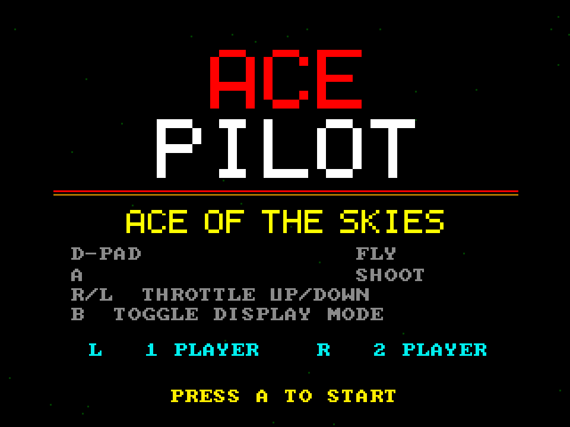

# Ace Pilot
**Platform:** 3DO Interactive Multiplayer (ARM60, Portfolio OS; Opera emulator) · **Source:** `3do_dev/projects/ace_pilot/` · **Type:** game

A first-person 3D wireframe dogfighting game: biplanes and blimps over a gridded airfield, with a split-screen two-player mode, ported from the Amiga original (`amiga_mcp examples/ace_pilot`). The Amiga game and drawing code runs unchanged on the 3DO through `sdk/amiga`, a compatibility layer that implements graphics.library calls into an offscreen 320x256 buffer shown each frame as one MADAM cel scaled to 320x240, emulates Paula on the 3DO's DSP, and paces the game to 50 fps. The Blue Danube plays as a MOD loaded from the disc (`takeme/ace_pilot/blue_danube.mod`), and `input_3do.c` maps the 3DO pad onto the Amiga input API (pad 2 flies player 2). Its `test.py` (built on `tdo.porttest`) boots the ISO headless in the patched Opera emulator, waits for `AMIGA3DO: ready`, presses buttons, checks the game's log lines and measures the speed from the layer's `AMIGA3DO: frame=` lines. It holds 50 logic steps per second while drawing about 26 frames per second. Native framebuffer 320x240, shown here at 3x (960x720, nearest-neighbour).

## Title screen

The red and white "ACE PILOT" logo over a red rule, "ACE OF THE SKIES" in yellow and the controls: D-PAD fly, A shoot, R/L throttle up/down, B toggle display mode. Blue "L 1 PLAYER  R 2 PLAYER" and "PRESS A TO START".

## Gameplay

A few seconds after take-off in the default colour mode: the green perspective ground grid with the runway's converging lines, orange ground targets scattered across the field, white wireframe shapes near the horizon and a red enemy plane at upper left. The HUD shows score 0000000, three reserve planes, wave W1, ALT:300 and SPD:8, with the white gunsight in the centre.

**Controls:** D-pad: pitch and yaw · A: machine gun · L / R: throttle down / up · B: toggle classic green or colour display · Title: L = 1 player, R = 2 players, A starts · X: back to the title / arcade menu
