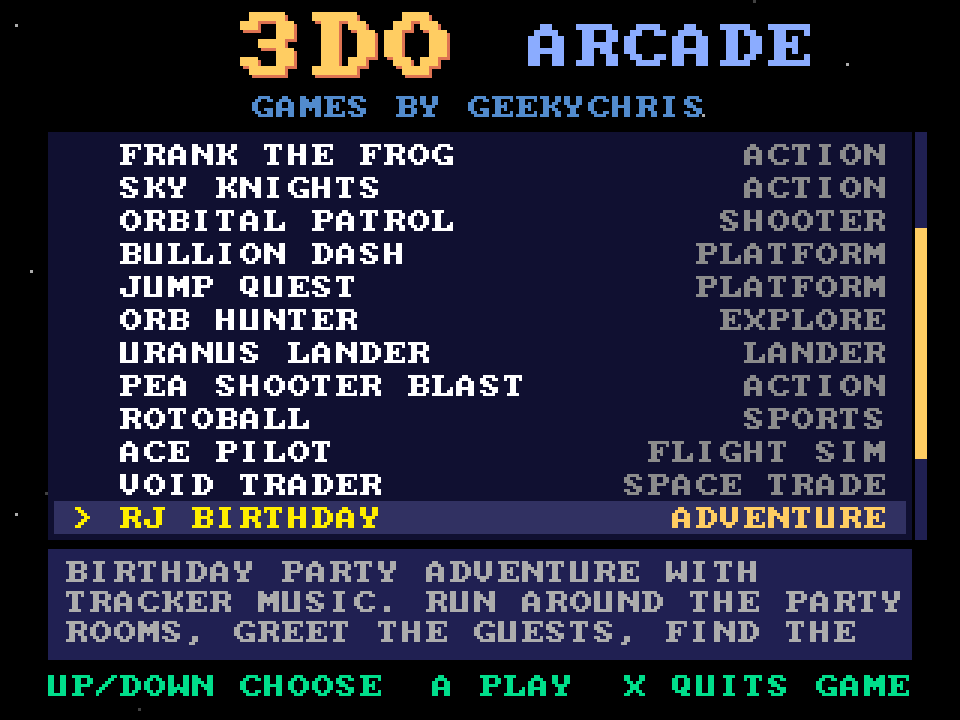
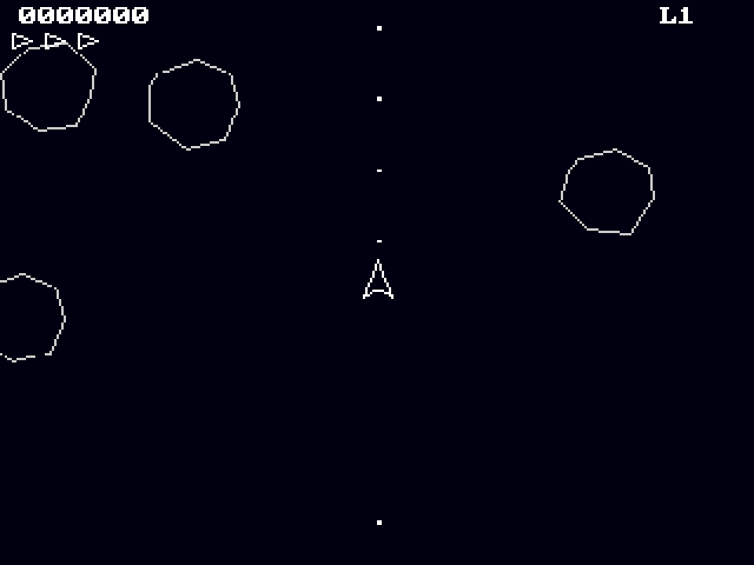

# 3DO Arcade
**Platform:** 3DO Interactive Multiplayer (ARM60, Portfolio OS; Opera emulator) · **Source:** `3do_dev/projects/arcade/` · **Type:** tool

The arcade disc: a game selector that bundles every Amiga-layer game on one CD. Its list is generated at build time from each project's `arcade.txt` (title, genre, order, description), every game sits on the disc as `$boot/<game>/<game>` with its data, and `launch.c` starts the chosen one; X inside a game returns to the menu. Its `test.py` boots it headless, waits for `ARCADE: menu`, launches the first game and checks it comes back. Native framebuffer 320x240, shown here at 3x (960x720, nearest-neighbour).

## Menu

"3DO ARCADE / GAMES BY GEEKYCHRIS" over a list of games with their genres (Rock Blaster, Nova Defense, Dot Chase, StakAttack, Lunar Rider, Frank the Frog, Sky Knights, Orbital Patrol, Bullion Dash, Jump Quest, Orb Hunter, Uranus Lander…), Rock Blaster highlighted, a scroll bar on the right, its description in the box below ("VECTOR SPACE SHOOTER. ROTATE, THRUST AND BLAST THE DRIFTING ROCKS…") and "UP/DOWN CHOOSE  A PLAY  X QUITS GAME".

## Menu, scrolled to the end

Scrolled down to the last entry, RJ Birthday (adventure), after Pea Shooter Blast, Rotoball (sports), Ace Pilot (flight sim) and Void Trader (space trade); the scroll bar has moved down and the box shows "BIRTHDAY PARTY ADVENTURE WITH TRACKER MUSIC…".

## A game launched from the menu

Rock Blaster running after being launched from the menu: the white vector ship in the centre among large outlined rocks, score 0000000, three reserve ships and level L1.

**Controls:** Up / Down: choose · Left / Right: page · A, C or P: play · X (in a game): back to the menu
