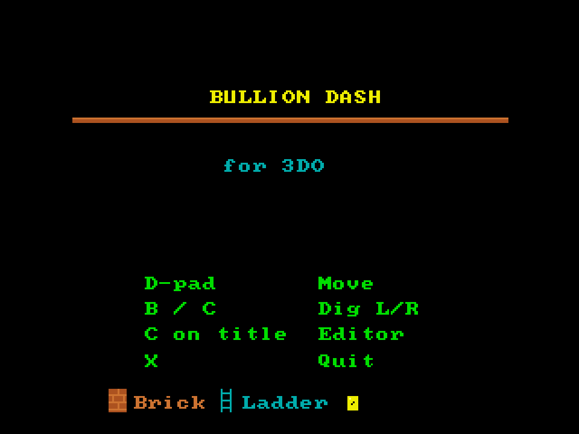

# Bullion Dash
**Platform:** 3DO Interactive Multiplayer (ARM60, Portfolio OS; Opera emulator) · **Source:** `3do_dev/projects/bullion_dash/` · **Type:** game

A puzzle platformer: collect all the gold, dig traps for the guards and climb out, with a built-in level editor (C on the title). Ported from the Amiga original (`amiga_mcp examples/bullion_dash`). The Amiga game and drawing code runs unchanged on the 3DO through `sdk/amiga`, a compatibility layer that implements graphics.library calls into an offscreen 320x256 buffer shown each frame as one MADAM cel scaled to 320x240, emulates Paula on the 3DO's DSP, and paces the game to 50 fps. Its `test.py` (built on `tdo.porttest`) boots the ISO headless in the patched Opera emulator, waits for `AMIGA3DO: ready`, presses buttons, checks the game's log lines and measures the speed from the layer's `AMIGA3DO: frame=` lines. Native framebuffer 320x240, shown here at 3x (960x720, nearest-neighbour).

## Title screen

"BULLION DASH" in yellow above an orange rule, "for 3DO" in cyan, the controls (D-pad Move, B / C Dig L/R, C on title Editor, X Quit) in green, and a legend of a brick, a ladder and gold at the bottom.

## Gameplay

Level 1: orange brick platforms linked by cyan ladders, five yellow gold bars to collect, the green player at bottom left and a red guard on the grey floor. HUD: SCORE:000000, LV:1, LIVES:3, GOLD:0/5.

**Controls:** D-pad: move / climb · B / C: dig left / right · A: fire · Title: C opens the editor (A put, B tile, L save, R load, P test) · X: quit to the menu
