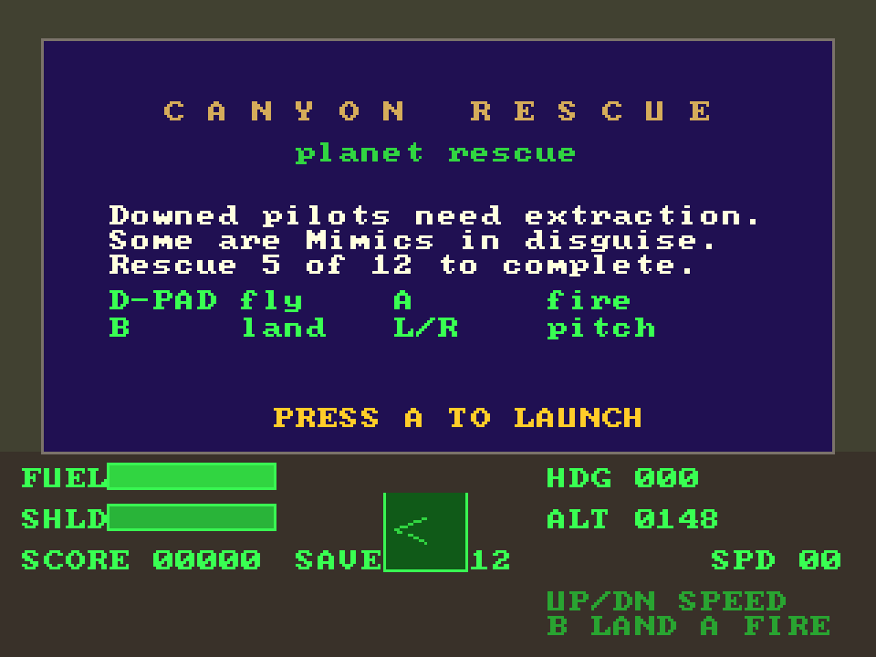

# Canyon Rescue
**Platform:** 3DO Interactive Multiplayer (ARM60, Portfolio OS; Opera emulator) · **Source:** `3do_dev/projects/canyon_rescue/` · **Type:** game

Fly the valleys of a fractal planet and rescue downed pilots, some of whom are Mimics in disguise, ported from the Amiga original (`amiga_mcp examples/canyon_rescue`). The original is written in C++, and the 3DO build compiles it with Norcroft's `armcpp` against the `sdk/amiga` layer; the voxel terrain's ray-march inner loop was rewritten in ARM assembly for the port (`src/fracmarch.s`). The game logic still runs at 50 steps per second while the terrain draws at about 9 frames per second. Its `test.py` (built on `tdo.porttest`) boots the ISO headless in the patched Opera emulator, waits for `AMIGA3DO: ready`, presses buttons, checks the game's log lines and measures the speed from the layer's `AMIGA3DO: frame=` lines. Native framebuffer 320x240, shown here at 3x (960x720, nearest-neighbour).

## Title screen

A blue panel with "CANYON RESCUE / planet rescue" and the briefing "Downed pilots need extraction. Some are Mimics in disguise. Rescue 5 of 12 to complete.", the controls and "PRESS A TO LAUNCH", above the cockpit HUD (FUEL and SHLD bars, SCORE 00000, SAVE 12, HDG 000, ALT 0148, SPD 00, a radar box).

## Gameplay

Flying low over the voxel landscape: green and ochre ridges under a purple-to-orange sky, a lit settlement on the horizon at right. The HUD reads HDG 168, ALT 0454, SPD 32.

**Controls:** Up / Down: thrust / brake · Left / Right: turn · L / R: climb / dive · A: fire · B: land · A or P: launch
