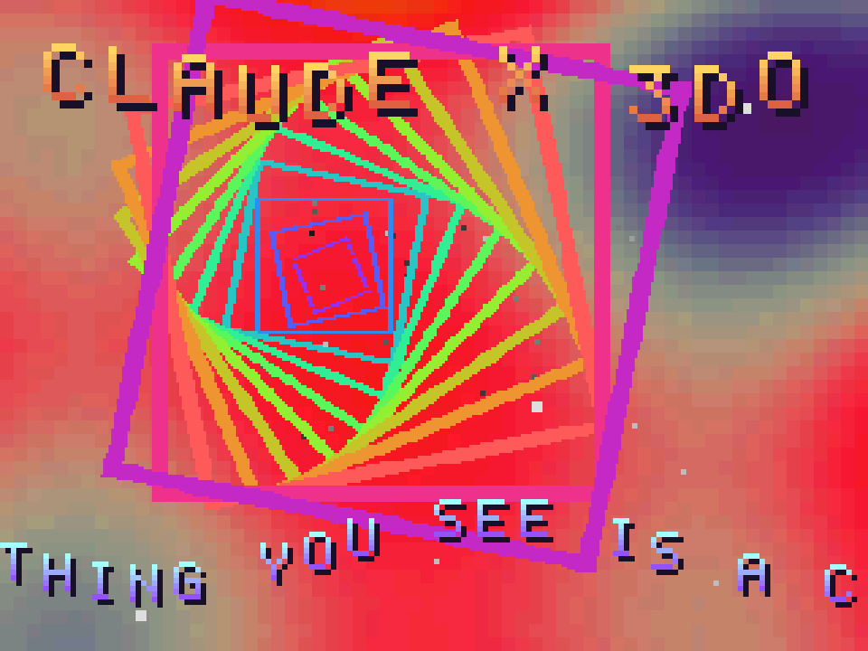
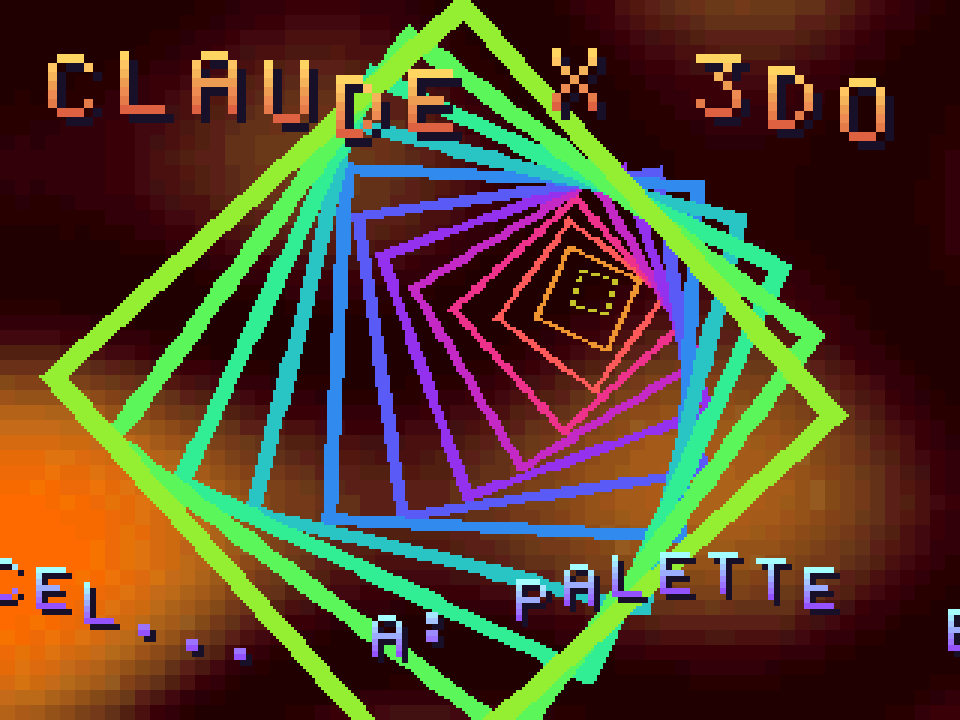

# CLAUDE x 3DO demo
**Platform:** 3DO Interactive Multiplayer (ARM60, Portfolio OS; Opera emulator) · **Source:** `3do_dev/projects/demo/` · **Type:** demo

A small cel-engine demo, written from scratch for the 3DO rather than ported. Everything on screen is a cel drawn with one `DrawCels()` call per frame: a 64x48 16-bit plasma recomputed in software every frame and stretched 5x by the cel engine (80x60 dropped it to 30 fps), a 3D starfield whose brightness comes from each cel's PIXC multiplier, a vortex of hollow squares rotated and zoomed through HDX/HDY/VDX/VDY with colour cycling done by swapping `ccb_SourcePtr`, per-letter bouncing title cels and a sine scroller. Its `test.py` measures the frame rate from periodic status lines; it holds 60 fps. Native framebuffer 320x240, shown here at 3x (960x720, nearest-neighbour).

## Plasma and vortex

"CLAUDE X 3DO" in chrome letters over a red, pink and grey plasma, with a rainbow vortex of rotating squares in the centre and the scroller "THING YOU SEE IS A C…" along the bottom.

## Another palette

Later, with a different plasma palette (dark reds and browns): the vortex has grown and turned green and yellow, and the scroller reads "…CEL… A: PALETTE".

**Controls:** A: next plasma palette · B: vortex on/off · C: starfield on/off · Up / Down: plasma speed · Left / Right: vortex spin · L / R: font style · P: pause · X: quit
