# 3DO DevBench — web UI, REST API and MCP for the 3DO emulator

`./3do devbench` (in `3do_dev`) starts one local Starlette server on :3330 that holds everything you can do to a running 3DO:
a **web UI** (Dashboard, Screen, OS, Debug, Memory, Console, API), a **REST API** with an OpenAPI spec, a Server-Sent Events
stream (status, debug console, CPU stop/run, crashes) and the **MCP server** over streamable HTTP at `/mcp`, the same server
Claude Code uses over stdio. It talks to emulator sessions over their control sockets, so sessions started by `./3do run`, MCP's
`emu_boot` or the UI itself all show up, and several clients can drive the same session.

Its layout follows the Amiga DevBench, but where the Amiga version gets its data from a bridge daemon on the Amiga over serial,
everything here comes from the patched Opera emulator: no guest code is needed, nothing is perturbed, it keeps working while the
CPU is halted or the program has crashed, and system-call tracing sees every `SWI` from every task. The OS views read Portfolio's
own kernel structures (tasks, items, ports, semaphores, devices, folios, memory pages) out of guest RAM.

Captured 2026-10-20 from a real session: Spectral Keep booted paused through the REST API, a `title` snapshot taken on its
title screen, then played into the game. Screens are 1440 CSS px wide at 2x; each has a plain and an annotated version
(callout boxes from the DOM's `getBoundingClientRect()`, rendered by `portfolio/tools/annotate.py` from the specs in
[`annotations/`](annotations/)).

| | Screen | |
|---|---|---|
|  | [Dashboard](dashboard.md) | The landing page: which emulator sessions are running (DevBench's own, `./3do run` windows, headless MCP sessions), a form to start one on any disc, an OS summary read straight from the 3DO kernel in guest RAM, and every project with build / run / test buttons. |
|  | [Screen & input](screen.md) | The live display of the selected session with an on-screen control pad, keyboard control, per-port peripherals (joypad, flightstick, mouse, light gun, trackball), analog sliders and screenshot / GIF capture. |
| 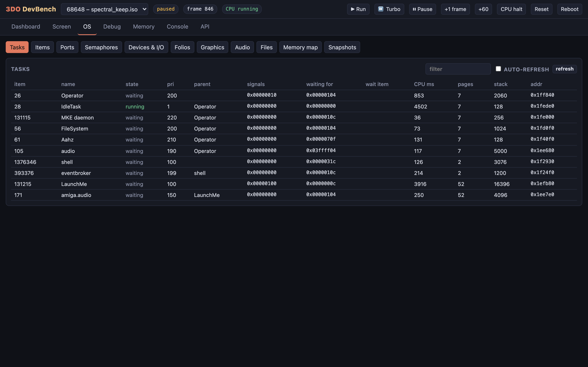 | [OS · Tasks](os-tasks.md) | Portfolio's task list read from guest RAM, with no code running on the 3DO side: state, priority, parent, signal bits, CPU time, owned pages and stack. |
| 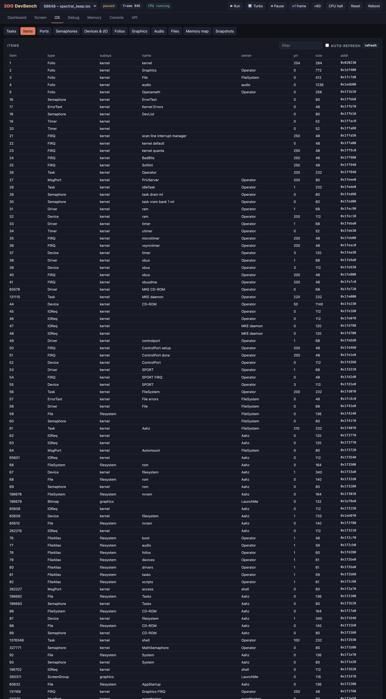 | [OS · Items](os-items.md) | Every live kernel item (folios, tasks, semaphores, devices, timers, IOReqs, files, message ports, screens…) with type, subsystem, name, owner, priority, size and address; clicking a row opens its detail. |
|  | [OS · Ports](os-ports.md) | Message ports with owner, queued messages and signal bit: here PrivServer (Operator), Automount (FileSystem), the shell's access and NonPrivServer ports, eventbroker's and the game's own (LaunchMe), none with queued messages. |
| 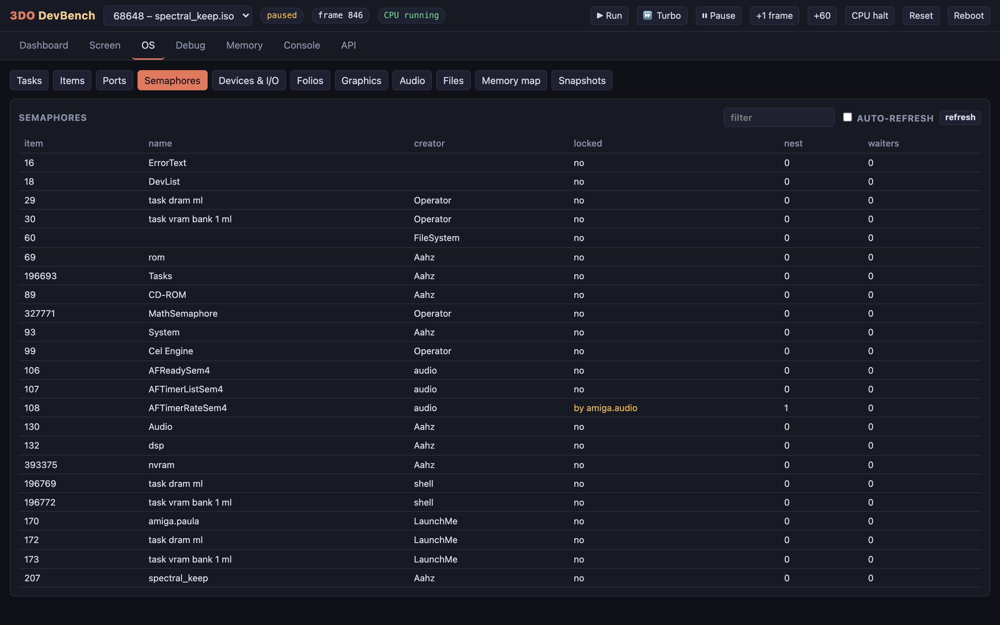 | [OS · Semaphores](os-semaphores.md) | Every semaphore with its creator, whether it is locked and by whom, nest count and waiters; kernel ones (ErrorText, DevList, the Cel Engine, MathSemaphore, nvram…) and the audio folio's; at the moment of the capture AFTimerRateSem4 is locked by `amiga.audio`, the Amiga layer's audio thread. |
| 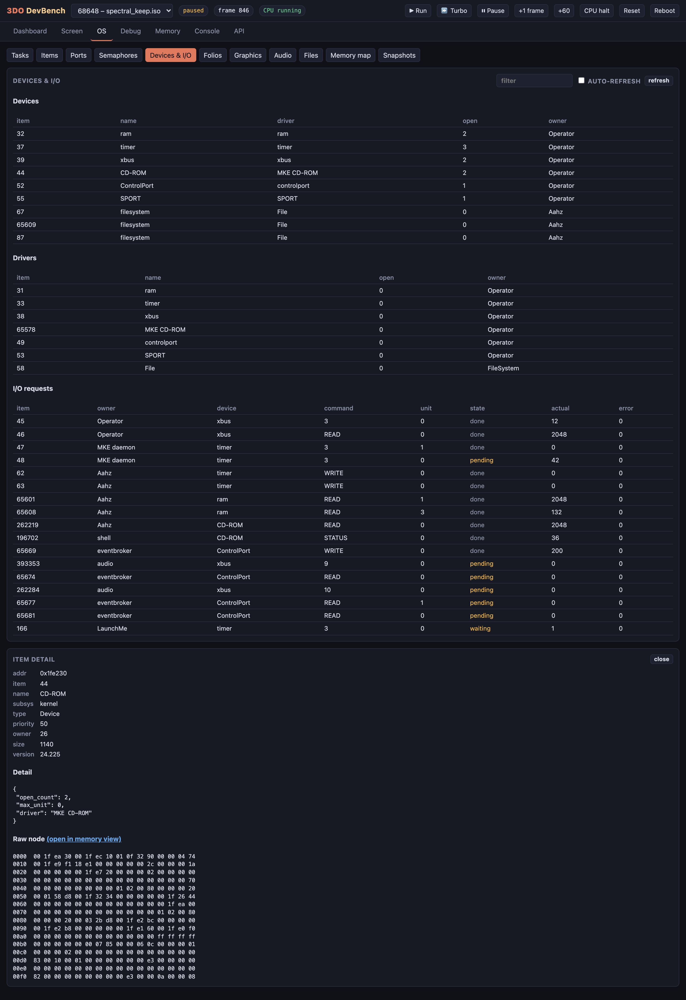 | [OS · Devices & I/O + item detail](os-devices.md) | Devices with their drivers and open counts, the loaded drivers, and every I/O request (owner, device, command, unit, bytes, error, pending or done), with one item opened in detail: the CD-ROM device (item 44), its node fields, type-specific detail (open count 2, driver MKE CD-ROM) and raw node bytes. |
| 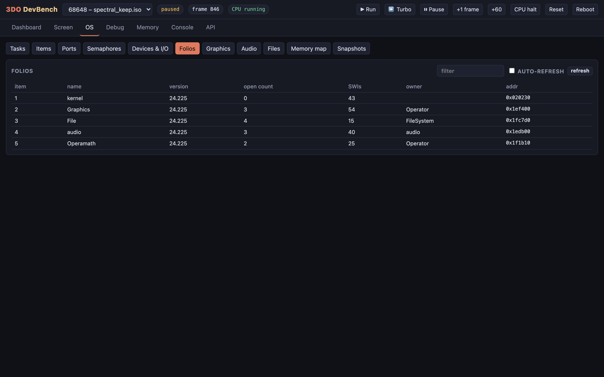 | [OS · Folios](os-folios.md) | The five loaded folios (kernel, Graphics, File, audio, Operamath), all version 24.225, with open counts, number of SWI functions (kernel 43, Graphics 54, File 15, audio 40, Operamath 25), owner and address. |
| 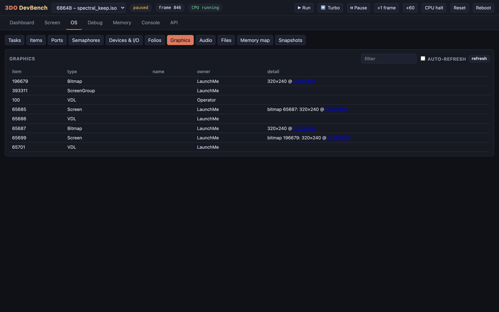 | [OS · Graphics](os-graphics.md) | Graphics-folio items: the game's (LaunchMe) screen group, its two screens and their 320x240 bitmaps (the double buffer, at 0x200000 and 0x225800 in VRAM, linked to the Memory tab) and the VDLs. |
| 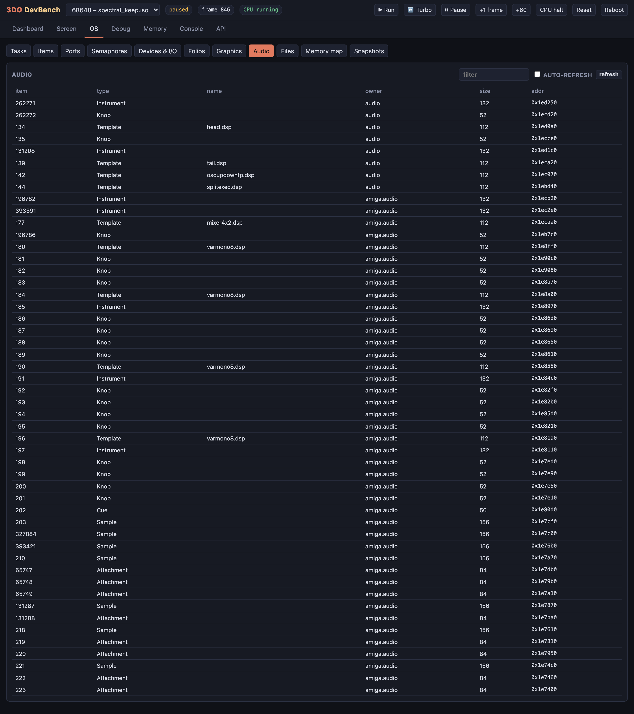 | [OS · Audio](os-audio.md) | Audio-folio items: the audio folio's own (head.dsp, tail.dsp…) and those of `amiga.audio`, the Amiga layer's Paula emulation: a `mixer4x2.dsp` mixer and `varmono8.dsp` sample players, one per Paula channel, with their knobs, plus the game's samples and attachments. |
| 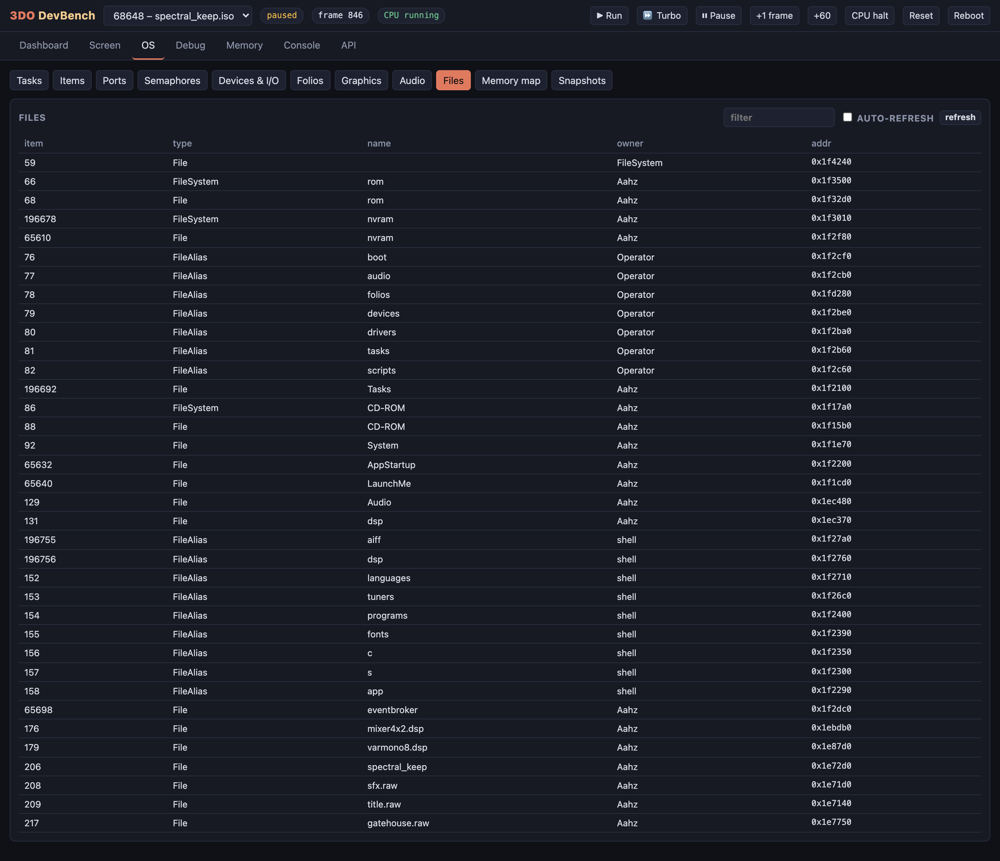 | [OS · Files](os-files.md) | File systems (rom, nvram, CD-ROM), the standard file aliases (boot, audio, folios, devices, drivers, tasks, scripts) and open files such as System, AppStartup, LaunchMe and Audio, with their owners and addresses. |
|  | [OS · Memory map](os-memory-map.md) | Page ownership from the kernel's free-page bitmaps: DRAM in 64 pages of 32 KB (13 free) and VRAM in 64 pages of 16 KB (44 free), coloured by owning task; the item detail from the previous view is still open below. |
|  | [OS · Snapshot diff](os-snapshots.md) | A snapshot named `title` was taken (through the REST API) on Spectral Keep's title screen; the game was then started and played for a while, and *diff vs now* compares the two: frames elapsed, the net item change by type (+4 samples and +4 attachments owned by `amiga.audio`, +1 message, +1 file), items created and deleted, and CPU time per task over the interval (LaunchMe 3214 ms). |
| 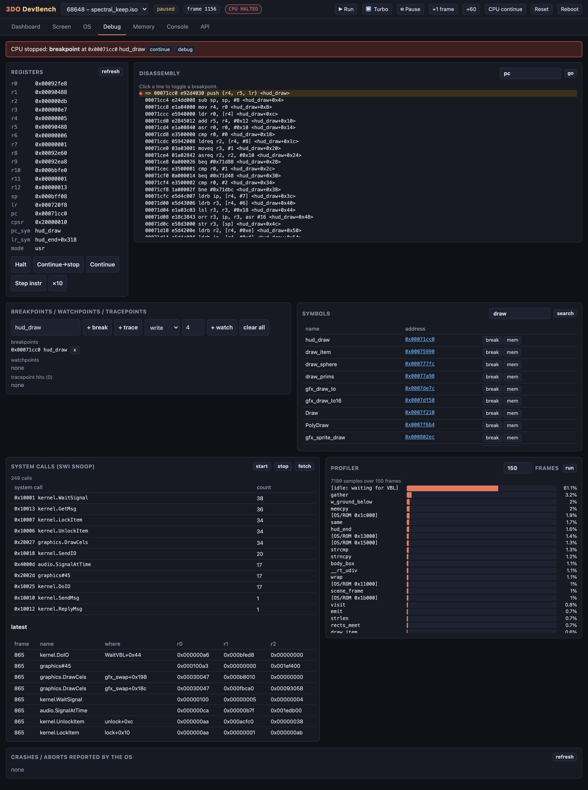 | [Debug](debug.md) | The debugger, stopped at a breakpoint on `hud_draw`: the stop banner, registers (pc symbolised as `hud_draw`, lr in `hud_end+0x318`), ARM disassembly with symbol offsets, the breakpoint list, a symbol search for `draw`, an SWI snoop of 249 system calls (kernel.WaitSignal, graphics.DrawCels, audio.SignalAtTime…, with the latest calls' callers and arguments), and a 150-frame profile showing 61% idle waiting for VBL with the rest spread over `gather`, `w_ground_below`, `memcpy` and OS/ROM time. |
| 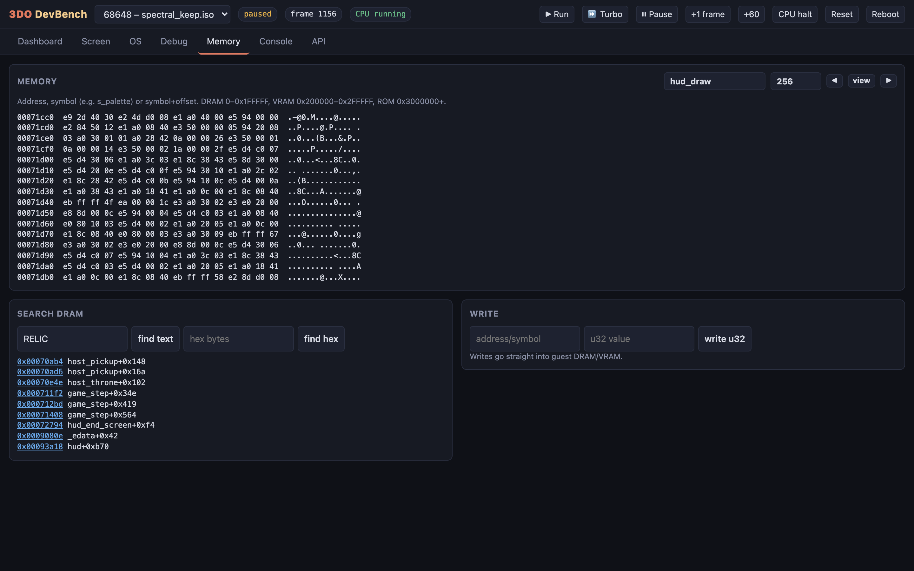 | [Memory](memory.md) | A hex/ASCII view addressed by symbol (here 256 bytes of code at `hud_draw`), a DRAM search (here for the text "RELIC", with hits labelled by the symbol they fall in, such as `host_pickup`, `game_step` and `hud_end_screen`) and a 32-bit write into guest memory. |
| 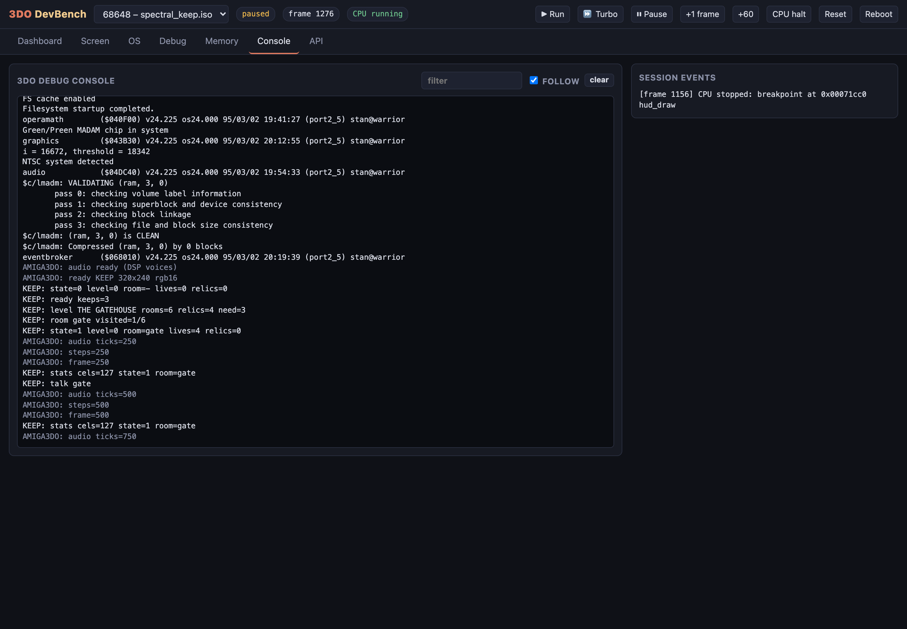 | [Console](console.md) | The 3DO debug console live: the kernel's boot messages (filesystem, MADAM / CLIO, audio folio, the CD image validation passes), then the game's own `tdo_log` lines (`KEEP: ready keeps=3`, `KEEP: state=1 level=0 room=gate`, `KEEP: talk gate`…) and the Amiga layer's `AMIGA3DO:` lines dimmed. |
| 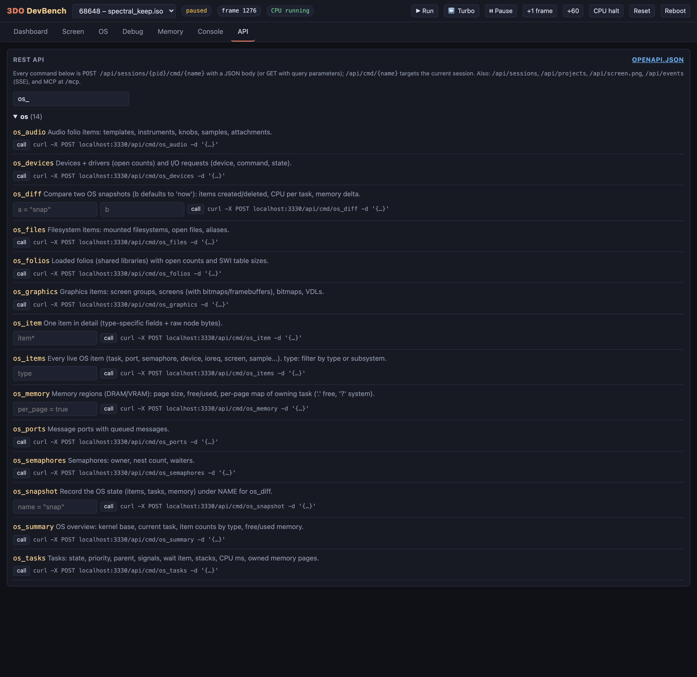 | [API explorer](api.md) | Every session command (~70) as REST: filter them, read each one's description and parameters, call it from the form and copy its curl line. |
