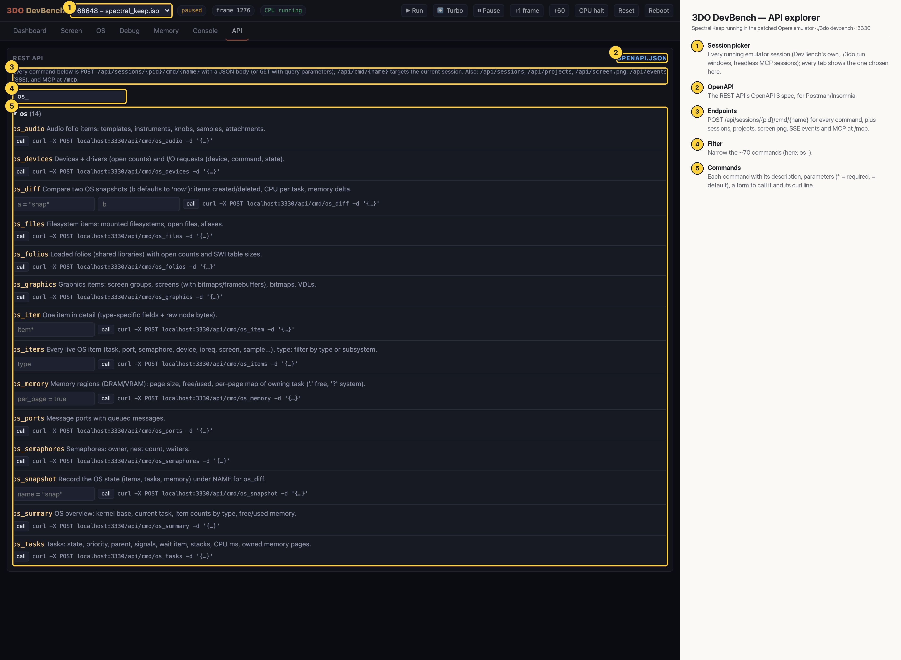

# 3DO DevBench — API explorer

Every session command (~70) as REST: filter them, read each one's description and parameters, call it from the form and copy its curl line. Here filtered to the OS-introspection commands (`os_audio`, `os_devices`, `os_diff`, `os_files`, `os_folios`, `os_graphics`, `os_item`, `os_items`, `os_memory`, `os_ports`, `os_semaphores`, `os_snapshot`, `os_summary`, `os_tasks`); the same commands are MCP tools at `/mcp`.

## Annotated

1. **Session picker** — Every running emulator session (DevBench's own, ./3do run windows, headless MCP sessions); every tab shows the one chosen here.
2. **OpenAPI** — The REST API's OpenAPI 3 spec, for Postman/Insomnia.
3. **Endpoints** — POST /api/sessions/{pid}/cmd/{name} for every command, plus sessions, projects, screen.png, SSE events and MCP at /mcp.
4. **Filter** — Narrow the ~70 commands (here: os_).
5. **Commands** — Each command with its description, parameters (* = required, = default), a form to call it and its curl line.
