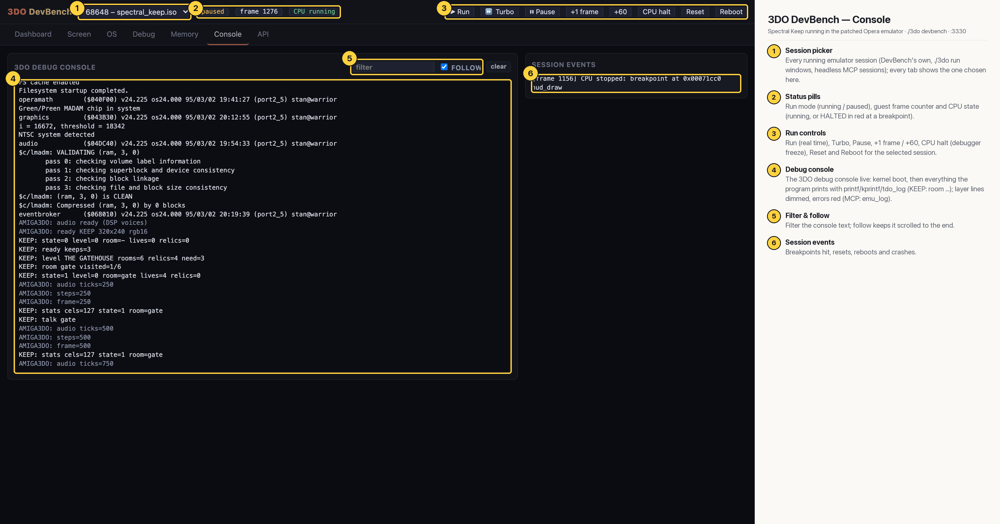

# 3DO DevBench — Console

The 3DO debug console live: the kernel's boot messages (filesystem, MADAM / CLIO, audio folio, the CD image validation passes), then the game's own `tdo_log` lines (`KEEP: ready keeps=3`, `KEEP: state=1 level=0 room=gate`, `KEEP: talk gate`…) and the Amiga layer's `AMIGA3DO:` lines dimmed. Session events on the right show the breakpoint hit at `hud_draw`.

## Annotated

1. **Session picker** — Every running emulator session (DevBench's own, ./3do run windows, headless MCP sessions); every tab shows the one chosen here.
2. **Status pills** — Run mode (running / paused), guest frame counter and CPU state (running, or HALTED in red at a breakpoint).
3. **Run controls** — Run (real time), Turbo, Pause, +1 frame / +60, CPU halt (debugger freeze), Reset and Reboot for the selected session.
4. **Debug console** — The 3DO debug console live: kernel boot, then everything the program prints with printf/kprintf/tdo_log (KEEP: room …); layer lines dimmed, errors red (MCP: emu_log).
5. **Filter & follow** — Filter the console text; follow keeps it scrolled to the end.
6. **Session events** — Breakpoints hit, resets, reboots and crashes.
