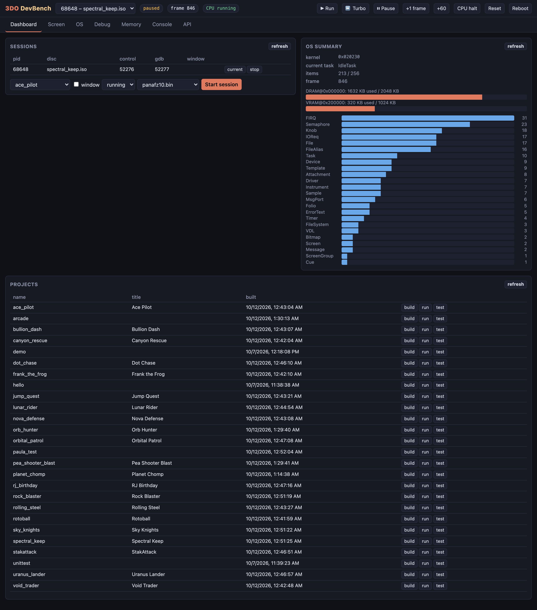
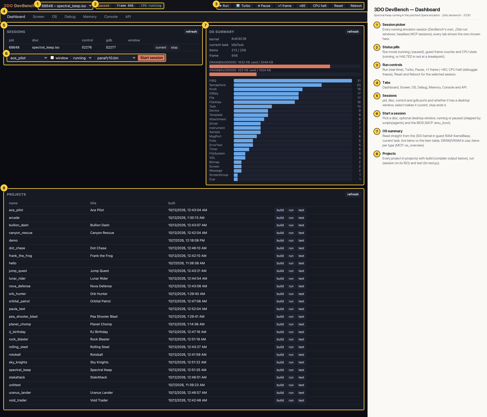

# 3DO DevBench — Dashboard

The landing page: which emulator sessions are running (DevBench's own, `./3do run` windows, headless MCP sessions), a form to start one on any disc, an OS summary read straight from the 3DO kernel in guest RAM, and every project with build / run / test buttons. Here one session runs Spectral Keep; the OS summary shows 213 of 256 kernel items in use, 1632 KB of 2 MB DRAM and 320 KB of 1 MB VRAM, and a bar per item type (FIRQ, Semaphore, Knob, IOReq, File…).

## Annotated

1. **Session picker** — Every running emulator session (DevBench's own, ./3do run windows, headless MCP sessions); every tab shows the one chosen here.
2. **Status pills** — Run mode (running / paused), guest frame counter and CPU state (running, or HALTED in red at a breakpoint).
3. **Run controls** — Run (real time), Turbo, Pause, +1 frame / +60, CPU halt (debugger freeze), Reset and Reboot for the selected session.
4. **Tabs** — Dashboard, Screen, OS, Debug, Memory, Console and API.
5. **Sessions** — pid, disc, control and gdb ports and whether it has a desktop window; select makes it current, stop ends it.
6. **Start a session** — Pick a disc, optional desktop window, running or paused (stepped by scripts/agents) and the BIOS (MCP: emu_boot).
7. **OS summary** — Read straight from the 3DO kernel in guest RAM: KernelBase, current task, live items vs the item table, DRAM/VRAM in use, items per type (MCP: os_overview).
8. **Projects** — Every project in projects/ with build (compiler output below), run (session on its ISO) and test (its test.py).
