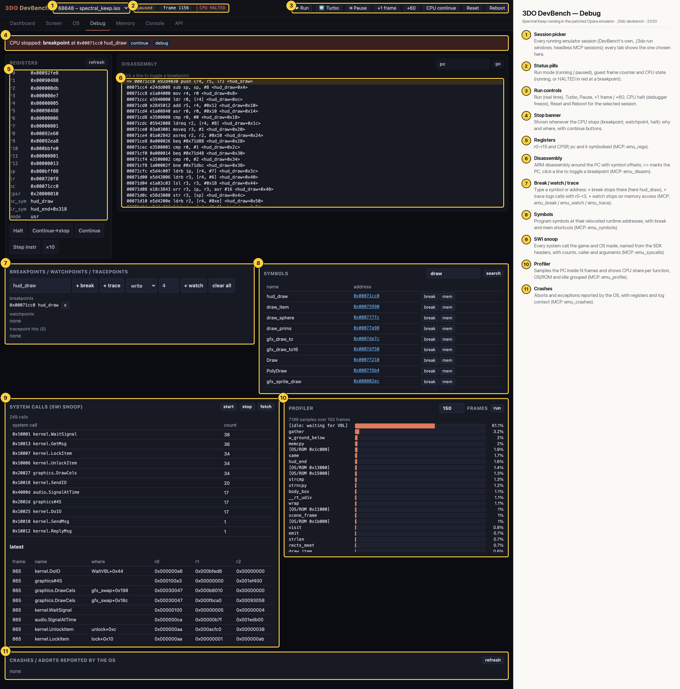

# 3DO DevBench — Debug

The debugger, stopped at a breakpoint on `hud_draw`: the stop banner, registers (pc symbolised as `hud_draw`, lr in `hud_end+0x318`), ARM disassembly with symbol offsets, the breakpoint list, a symbol search for `draw`, an SWI snoop of 249 system calls (kernel.WaitSignal, graphics.DrawCels, audio.SignalAtTime…, with the latest calls' callers and arguments), and a 150-frame profile showing 61% idle waiting for VBL with the rest spread over `gather`, `w_ground_below`, `memcpy` and OS/ROM time.

## Annotated

1. **Session picker** — Every running emulator session (DevBench's own, ./3do run windows, headless MCP sessions); every tab shows the one chosen here.
2. **Status pills** — Run mode (running / paused), guest frame counter and CPU state (running, or HALTED in red at a breakpoint).
3. **Run controls** — Run (real time), Turbo, Pause, +1 frame / +60, CPU halt (debugger freeze), Reset and Reboot for the selected session.
4. **Stop banner** — Shown whenever the CPU stops (breakpoint, watchpoint, halt): why and where, with continue buttons.
5. **Registers** — r0–r15 and CPSR; pc and lr symbolised (MCP: emu_regs).
6. **Disassembly** — ARM disassembly around the PC with symbol offsets; => marks the PC, click a line to toggle a breakpoint (MCP: emu_disasm).
7. **Break / watch / trace** — Type a symbol or address: + break stops there (here hud_draw), + trace logs calls with r0–r3, + watch stops on memory access (MCP: emu_break / emu_watch / emu_trace).
8. **Symbols** — Program symbols at their relocated runtime addresses, with break and mem shortcuts (MCP: emu_symbols).
9. **SWI snoop** — Every system call the game and OS made, named from the SDK headers, with counts, caller and arguments (MCP: emu_syscalls).
10. **Profiler** — Samples the PC inside N frames and shows CPU share per function, OS/ROM and idle grouped (MCP: emu_profile).
11. **Crashes** — Aborts and exceptions reported by the OS, with registers and log context (MCP: emu_crashes).
