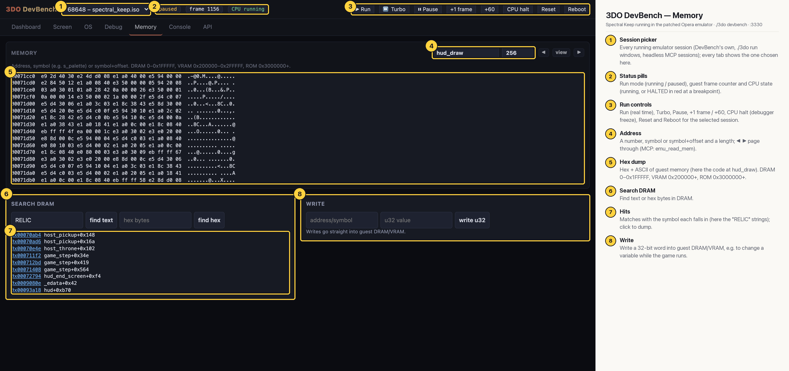

# 3DO DevBench — Memory

A hex/ASCII view addressed by symbol (here 256 bytes of code at `hud_draw`), a DRAM search (here for the text "RELIC", with hits labelled by the symbol they fall in, such as `host_pickup`, `game_step` and `hud_end_screen`) and a 32-bit write into guest memory.

## Annotated

1. **Session picker** — Every running emulator session (DevBench's own, ./3do run windows, headless MCP sessions); every tab shows the one chosen here.
2. **Status pills** — Run mode (running / paused), guest frame counter and CPU state (running, or HALTED in red at a breakpoint).
3. **Run controls** — Run (real time), Turbo, Pause, +1 frame / +60, CPU halt (debugger freeze), Reset and Reboot for the selected session.
4. **Address** — A number, symbol or symbol+offset and a length; ◀ ▶ page through (MCP: emu_read_mem).
5. **Hex dump** — Hex + ASCII of guest memory (here the code at hud_draw). DRAM 0–0x1FFFFF, VRAM 0x200000+, ROM 0x3000000+.
6. **Search DRAM** — Find text or hex bytes in DRAM.
7. **Hits** — Matches with the symbol each falls in (here the "RELIC" strings); click to dump.
8. **Write** — Write a 32-bit word into guest DRAM/VRAM, e.g. to change a variable while the game runs.
