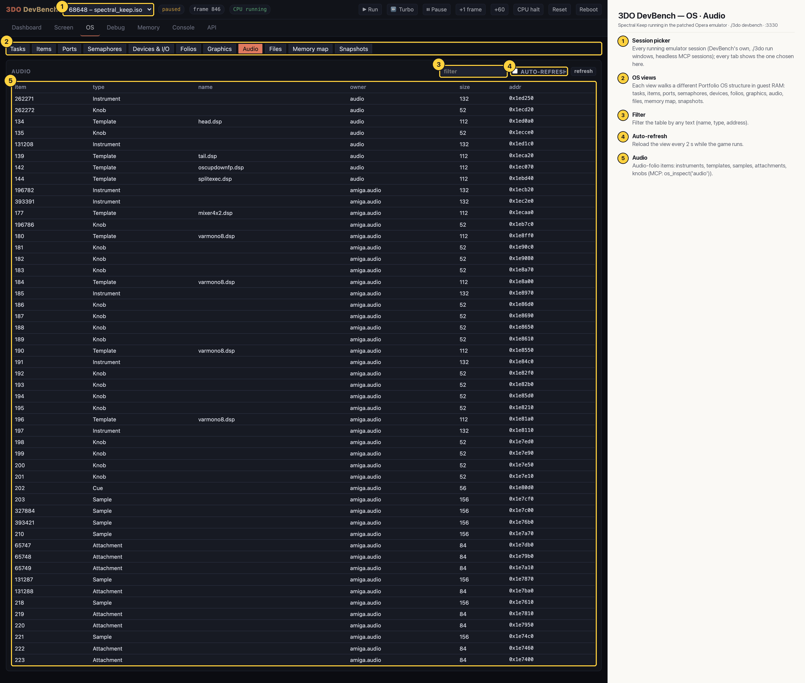

# 3DO DevBench — OS · Audio

Audio-folio items: the audio folio's own (head.dsp, tail.dsp…) and those of `amiga.audio`, the Amiga layer's Paula emulation: a `mixer4x2.dsp` mixer and `varmono8.dsp` sample players, one per Paula channel, with their knobs, plus the game's samples and attachments.

## Annotated

1. **Session picker** — Every running emulator session (DevBench's own, ./3do run windows, headless MCP sessions); every tab shows the one chosen here.
2. **OS views** — Each view walks a different Portfolio OS structure in guest RAM: tasks, items, ports, semaphores, devices, folios, graphics, audio, files, memory map, snapshots.
3. **Filter** — Filter the table by any text (name, type, address).
4. **Auto-refresh** — Reload the view every 2 s while the game runs.
5. **Audio** — Audio-folio items: instruments, templates, samples, attachments, knobs (MCP: os_inspect('audio')).
