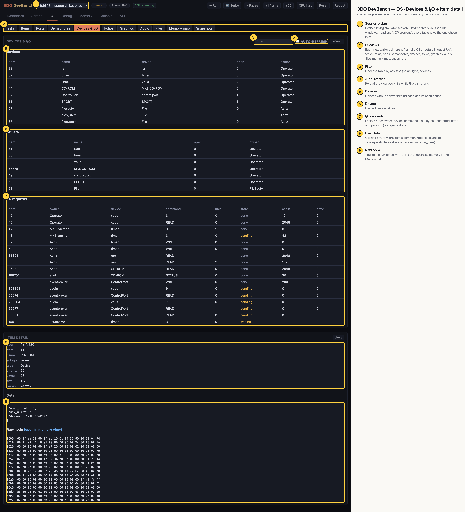

# 3DO DevBench — OS · Devices & I/O + item detail

Devices with their drivers and open counts, the loaded drivers, and every I/O request (owner, device, command, unit, bytes, error, pending or done), with one item opened in detail: the CD-ROM device (item 44), its node fields, type-specific detail (open count 2, driver MKE CD-ROM) and raw node bytes.

## Annotated

1. **Session picker** — Every running emulator session (DevBench's own, ./3do run windows, headless MCP sessions); every tab shows the one chosen here.
2. **OS views** — Each view walks a different Portfolio OS structure in guest RAM: tasks, items, ports, semaphores, devices, folios, graphics, audio, files, memory map, snapshots.
3. **Filter** — Filter the table by any text (name, type, address).
4. **Auto-refresh** — Reload the view every 2 s while the game runs.
5. **Devices** — Devices with the driver behind each and its open count.
6. **Drivers** — Loaded device drivers.
7. **I/O requests** — Every IOReq: owner, device, command, unit, bytes transferred, error, and pending (orange) or done.
8. **Item detail** — Clicking any row: the item's common node fields and its type-specific fields (here a device) (MCP: os_item(n)).
9. **Raw node** — The item's raw bytes, with a link that opens its memory in the Memory tab.
