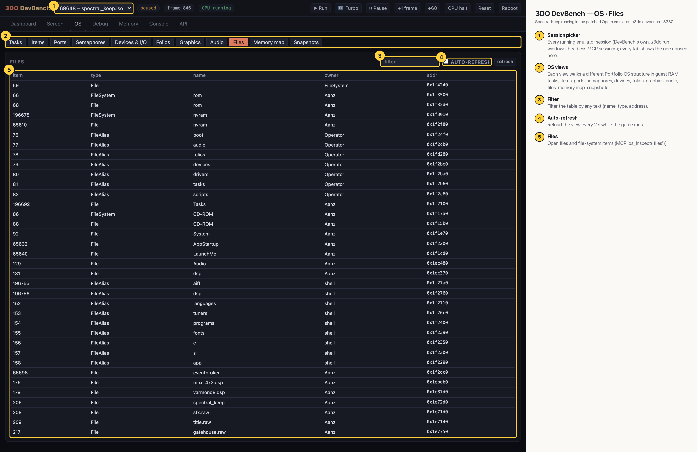

# 3DO DevBench — OS · Files

File systems (rom, nvram, CD-ROM), the standard file aliases (boot, audio, folios, devices, drivers, tasks, scripts) and open files such as System, AppStartup, LaunchMe and Audio, with their owners and addresses.

## Annotated

1. **Session picker** — Every running emulator session (DevBench's own, ./3do run windows, headless MCP sessions); every tab shows the one chosen here.
2. **OS views** — Each view walks a different Portfolio OS structure in guest RAM: tasks, items, ports, semaphores, devices, folios, graphics, audio, files, memory map, snapshots.
3. **Filter** — Filter the table by any text (name, type, address).
4. **Auto-refresh** — Reload the view every 2 s while the game runs.
5. **Files** — Open files and file-system items (MCP: os_inspect('files')).
