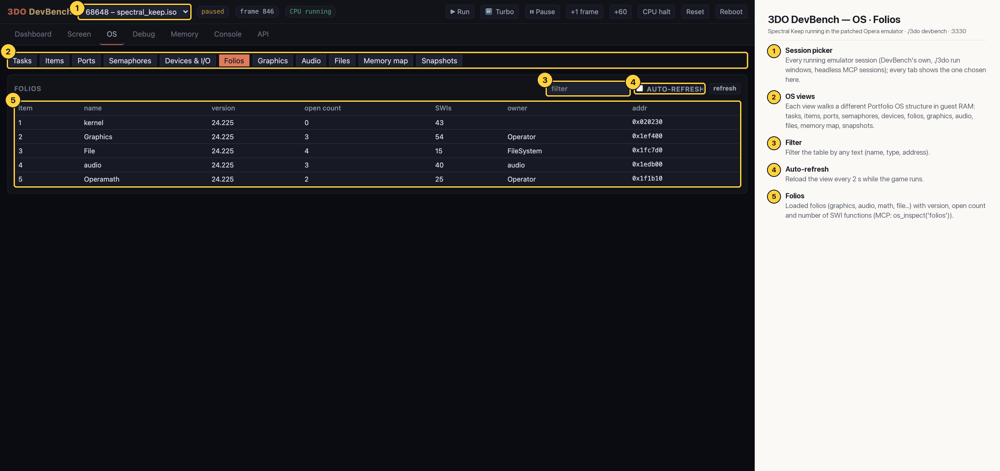

# 3DO DevBench — OS · Folios

The five loaded folios (kernel, Graphics, File, audio, Operamath), all version 24.225, with open counts, number of SWI functions (kernel 43, Graphics 54, File 15, audio 40, Operamath 25), owner and address.

## Annotated

1. **Session picker** — Every running emulator session (DevBench's own, ./3do run windows, headless MCP sessions); every tab shows the one chosen here.
2. **OS views** — Each view walks a different Portfolio OS structure in guest RAM: tasks, items, ports, semaphores, devices, folios, graphics, audio, files, memory map, snapshots.
3. **Filter** — Filter the table by any text (name, type, address).
4. **Auto-refresh** — Reload the view every 2 s while the game runs.
5. **Folios** — Loaded folios (graphics, audio, math, file…) with version, open count and number of SWI functions (MCP: os_inspect('folios')).
