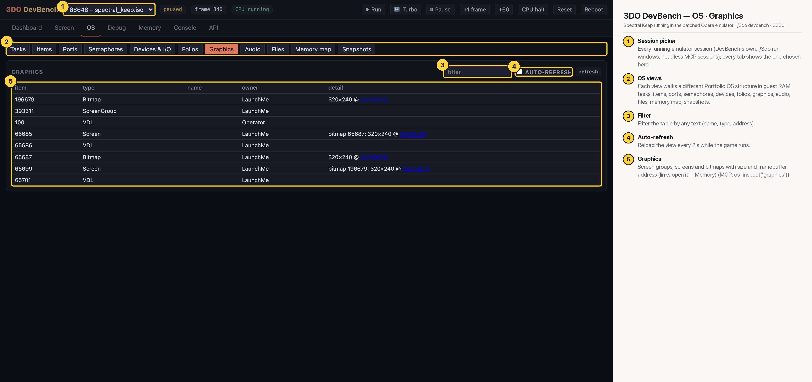

# 3DO DevBench — OS · Graphics

Graphics-folio items: the game's (LaunchMe) screen group, its two screens and their 320x240 bitmaps (the double buffer, at 0x200000 and 0x225800 in VRAM, linked to the Memory tab) and the VDLs.

## Annotated

1. **Session picker** — Every running emulator session (DevBench's own, ./3do run windows, headless MCP sessions); every tab shows the one chosen here.
2. **OS views** — Each view walks a different Portfolio OS structure in guest RAM: tasks, items, ports, semaphores, devices, folios, graphics, audio, files, memory map, snapshots.
3. **Filter** — Filter the table by any text (name, type, address).
4. **Auto-refresh** — Reload the view every 2 s while the game runs.
5. **Graphics** — Screen groups, screens and bitmaps with size and framebuffer address (links open it in Memory) (MCP: os_inspect('graphics')).
