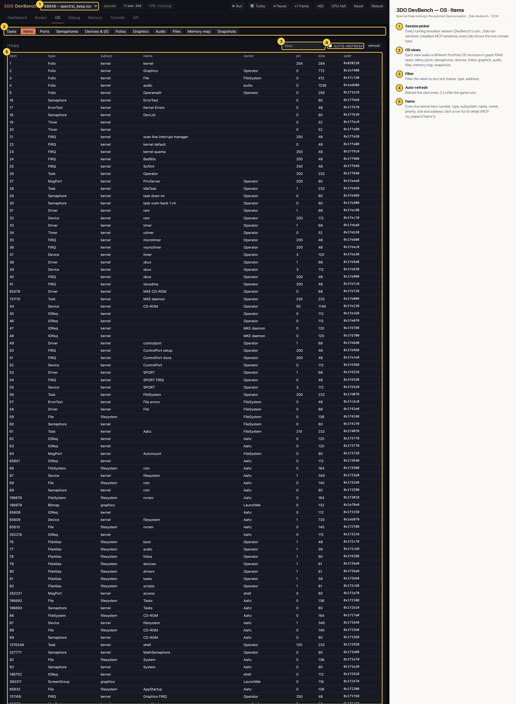

# 3DO DevBench — OS · Items

Every live kernel item (folios, tasks, semaphores, devices, timers, IOReqs, files, message ports, screens…) with type, subsystem, name, owner, priority, size and address; clicking a row opens its detail. The capture is cut off at the page height cap; the full table continues below.

## Annotated

1. **Session picker** — Every running emulator session (DevBench's own, ./3do run windows, headless MCP sessions); every tab shows the one chosen here.
2. **OS views** — Each view walks a different Portfolio OS structure in guest RAM: tasks, items, ports, semaphores, devices, folios, graphics, audio, files, memory map, snapshots.
3. **Filter** — Filter the table by any text (name, type, address).
4. **Auto-refresh** — Reload the view every 2 s while the game runs.
5. **Items** — Every live kernel item: number, type, subsystem, name, owner, priority, size and address; click a row for its detail (MCP: os_inspect('items')).
