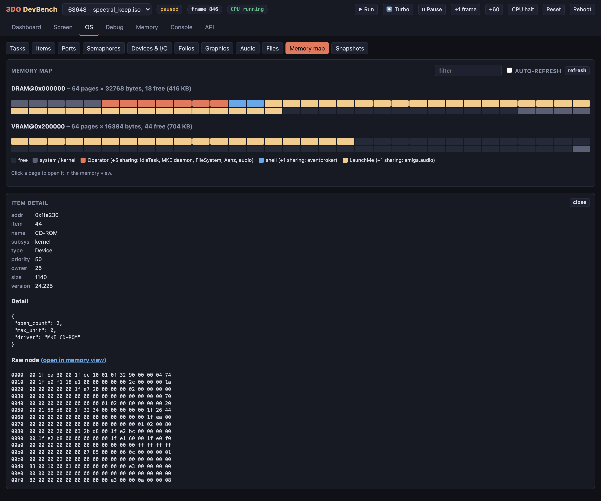
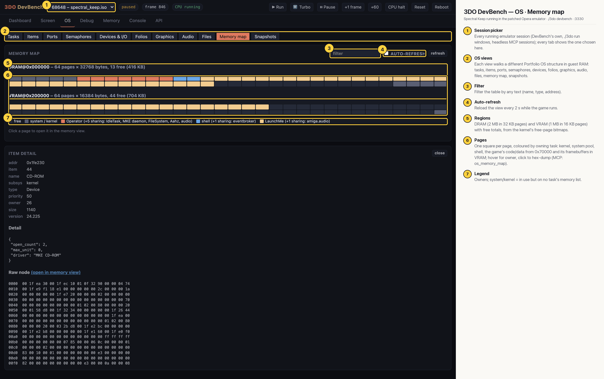

# 3DO DevBench — OS · Memory map

Page ownership from the kernel's free-page bitmaps: DRAM in 64 pages of 32 KB (13 free) and VRAM in 64 pages of 16 KB (44 free), coloured by owning task; the item detail from the previous view is still open below.

## Annotated

1. **Session picker** — Every running emulator session (DevBench's own, ./3do run windows, headless MCP sessions); every tab shows the one chosen here.
2. **OS views** — Each view walks a different Portfolio OS structure in guest RAM: tasks, items, ports, semaphores, devices, folios, graphics, audio, files, memory map, snapshots.
3. **Filter** — Filter the table by any text (name, type, address).
4. **Auto-refresh** — Reload the view every 2 s while the game runs.
5. **Regions** — DRAM (2 MB in 32 KB pages) and VRAM (1 MB in 16 KB pages) with free totals, from the kernel's free-page bitmaps.
6. **Pages** — One square per page, coloured by owning task: kernel, system pool, shell, the game's code/data from 0x70000 and its framebuffers in VRAM; hover for owner, click to hex-dump (MCP: os_memory_map).
7. **Legend** — Owners; system/kernel = in use but on no task's memory list.
