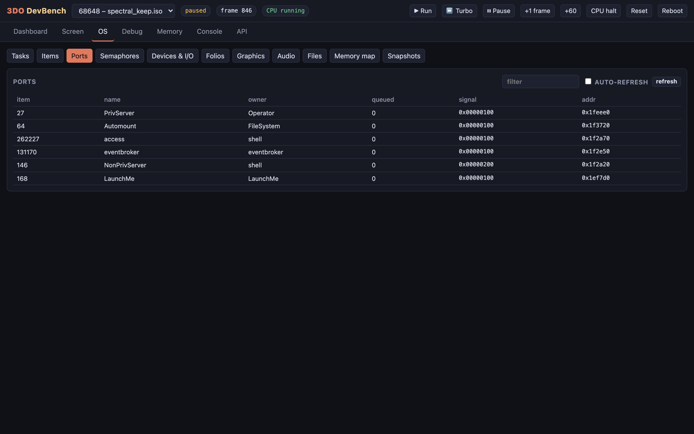
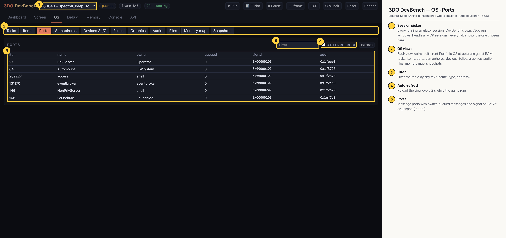

# 3DO DevBench — OS · Ports

Message ports with owner, queued messages and signal bit: here PrivServer (Operator), Automount (FileSystem), the shell's access and NonPrivServer ports, eventbroker's and the game's own (LaunchMe), none with queued messages.

## Annotated

1. **Session picker** — Every running emulator session (DevBench's own, ./3do run windows, headless MCP sessions); every tab shows the one chosen here.
2. **OS views** — Each view walks a different Portfolio OS structure in guest RAM: tasks, items, ports, semaphores, devices, folios, graphics, audio, files, memory map, snapshots.
3. **Filter** — Filter the table by any text (name, type, address).
4. **Auto-refresh** — Reload the view every 2 s while the game runs.
5. **Ports** — Message ports with owner, queued messages and signal bit (MCP: os_inspect('ports')).
