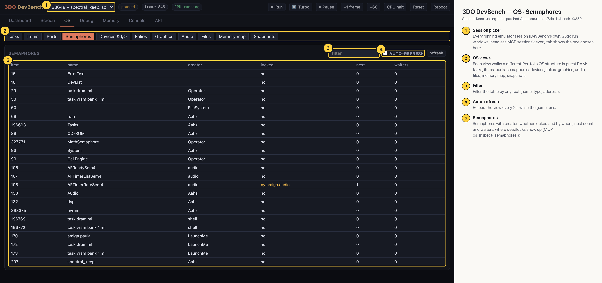

# 3DO DevBench — OS · Semaphores

Every semaphore with its creator, whether it is locked and by whom, nest count and waiters; kernel ones (ErrorText, DevList, the Cel Engine, MathSemaphore, nvram…) and the audio folio's; at the moment of the capture AFTimerRateSem4 is locked by `amiga.audio`, the Amiga layer's audio thread.

## Annotated

1. **Session picker** — Every running emulator session (DevBench's own, ./3do run windows, headless MCP sessions); every tab shows the one chosen here.
2. **OS views** — Each view walks a different Portfolio OS structure in guest RAM: tasks, items, ports, semaphores, devices, folios, graphics, audio, files, memory map, snapshots.
3. **Filter** — Filter the table by any text (name, type, address).
4. **Auto-refresh** — Reload the view every 2 s while the game runs.
5. **Semaphores** — Semaphores with creator, whether locked and by whom, nest count and waiters: where deadlocks show up (MCP: os_inspect('semaphores')).
