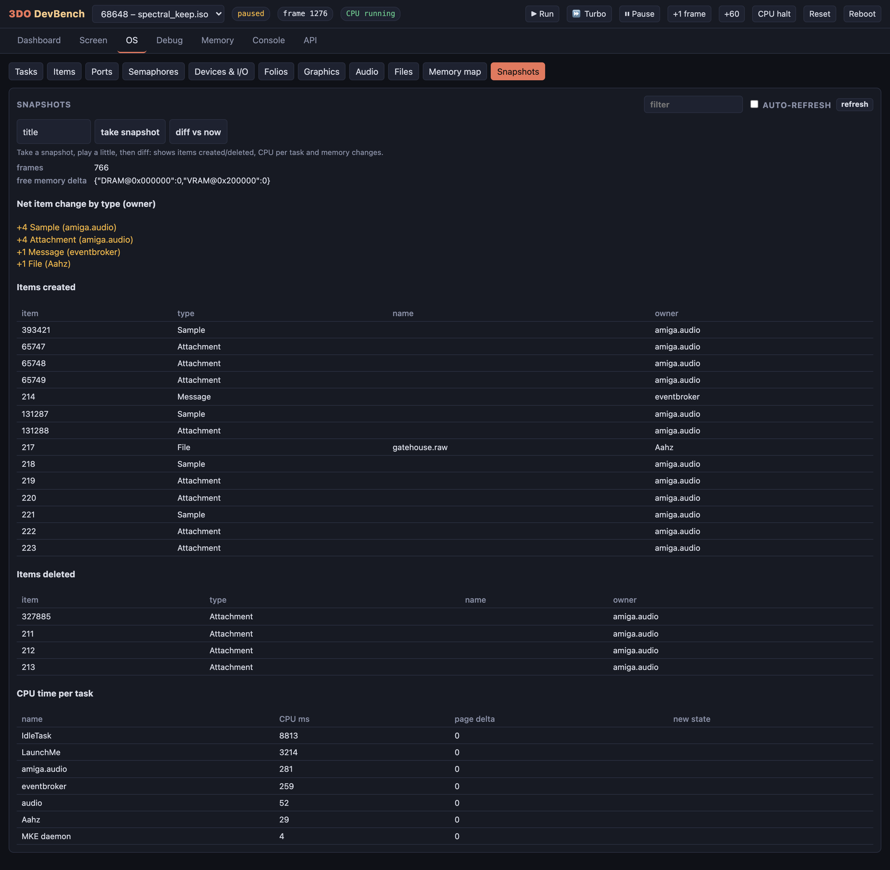
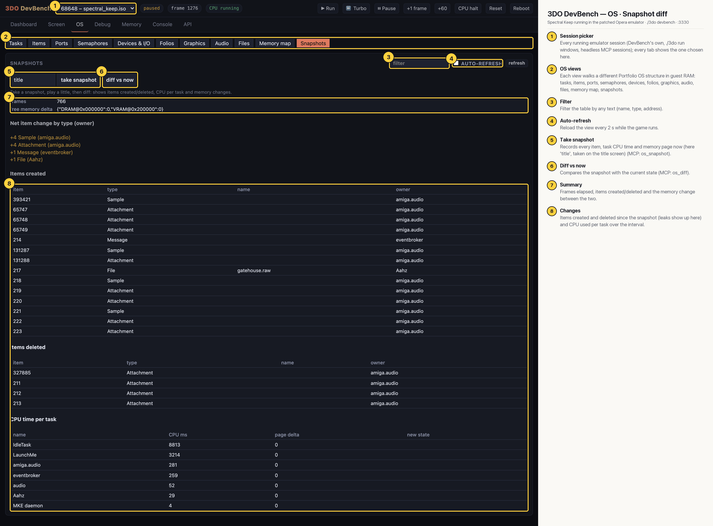

# 3DO DevBench — OS · Snapshot diff

A snapshot named `title` was taken (through the REST API) on Spectral Keep's title screen; the game was then started and played for a while, and *diff vs now* compares the two: frames elapsed, the net item change by type (+4 samples and +4 attachments owned by `amiga.audio`, +1 message, +1 file), items created and deleted, and CPU time per task over the interval (LaunchMe 3214 ms).

## Annotated

1. **Session picker** — Every running emulator session (DevBench's own, ./3do run windows, headless MCP sessions); every tab shows the one chosen here.
2. **OS views** — Each view walks a different Portfolio OS structure in guest RAM: tasks, items, ports, semaphores, devices, folios, graphics, audio, files, memory map, snapshots.
3. **Filter** — Filter the table by any text (name, type, address).
4. **Auto-refresh** — Reload the view every 2 s while the game runs.
5. **Take snapshot** — Records every item, task CPU time and memory page now (here 'title', taken on the title screen) (MCP: os_snapshot).
6. **Diff vs now** — Compares the snapshot with the current state (MCP: os_diff).
7. **Summary** — Frames elapsed, items created/deleted and the memory change between the two.
8. **Changes** — Items created and deleted since the snapshot (leaks show up here) and CPU used per task over the interval.
