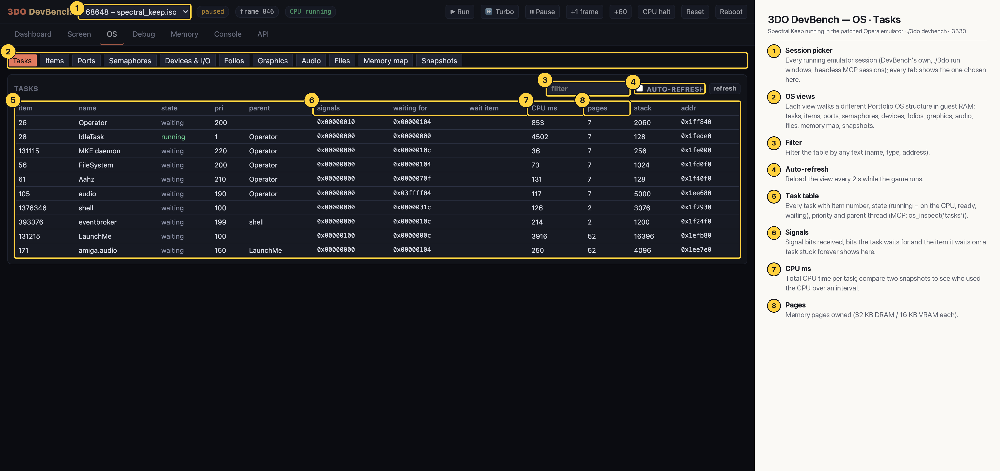

# 3DO DevBench — OS · Tasks

Portfolio's task list read from guest RAM, with no code running on the 3DO side: state, priority, parent, signal bits, CPU time, owned pages and stack. Here the game (`LaunchMe`, 52 pages, 3916 CPU ms) and its `amiga.audio` thread wait while `IdleTask` runs, alongside Operator, MKE daemon, FileSystem, Aahz, audio, shell and eventbroker.

## Annotated

1. **Session picker** — Every running emulator session (DevBench's own, ./3do run windows, headless MCP sessions); every tab shows the one chosen here.
2. **OS views** — Each view walks a different Portfolio OS structure in guest RAM: tasks, items, ports, semaphores, devices, folios, graphics, audio, files, memory map, snapshots.
3. **Filter** — Filter the table by any text (name, type, address).
4. **Auto-refresh** — Reload the view every 2 s while the game runs.
5. **Task table** — Every task with item number, state (running = on the CPU, ready, waiting), priority and parent thread (MCP: os_inspect('tasks')).
6. **Signals** — Signal bits received, bits the task waits for and the item it waits on: a task stuck forever shows here.
7. **CPU ms** — Total CPU time per task; compare two snapshots to see who used the CPU over an interval.
8. **Pages** — Memory pages owned (32 KB DRAM / 16 KB VRAM each).
