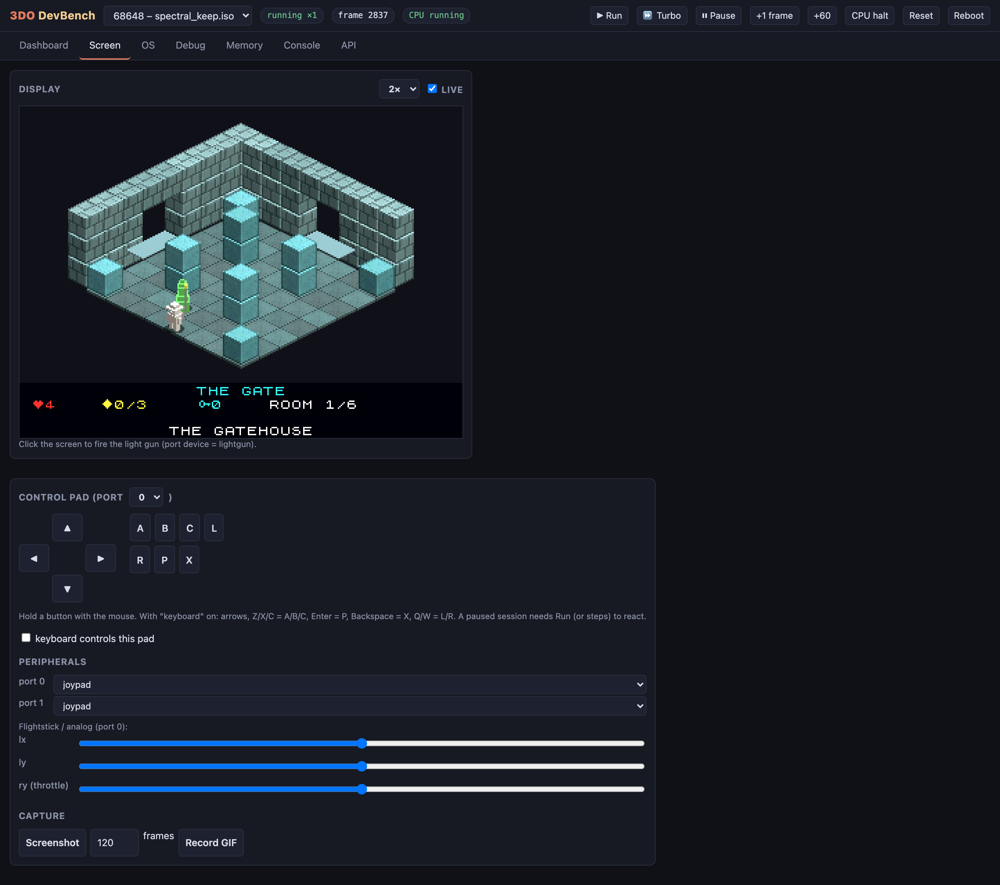
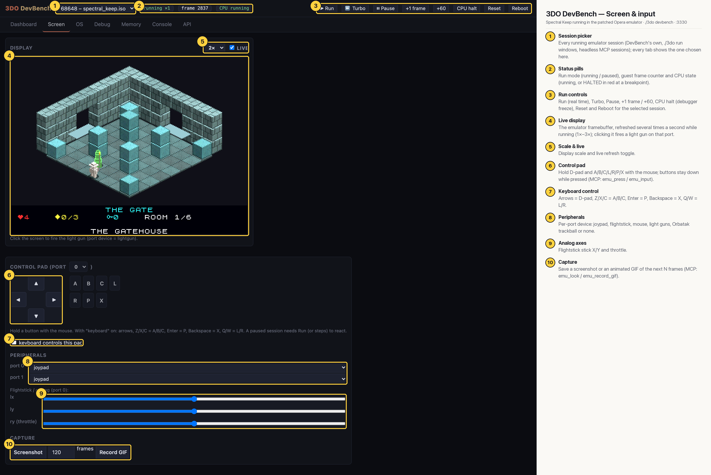

# 3DO DevBench — Screen & input

The live display of the selected session with an on-screen control pad, keyboard control, per-port peripherals (joypad, flightstick, mouse, light gun, trackball), analog sliders and screenshot / GIF capture. Here Spectral Keep is running in real time in The Gatehouse (room 1/6).

## Annotated

1. **Session picker** — Every running emulator session (DevBench's own, ./3do run windows, headless MCP sessions); every tab shows the one chosen here.
2. **Status pills** — Run mode (running / paused), guest frame counter and CPU state (running, or HALTED in red at a breakpoint).
3. **Run controls** — Run (real time), Turbo, Pause, +1 frame / +60, CPU halt (debugger freeze), Reset and Reboot for the selected session.
4. **Live display** — The emulator framebuffer, refreshed several times a second while running (1×–3×); clicking it fires a light gun on that port.
5. **Scale & live** — Display scale and live refresh toggle.
6. **Control pad** — Hold D-pad and A/B/C/L/R/P/X with the mouse; buttons stay down while pressed (MCP: emu_press / emu_input).
7. **Keyboard control** — Arrows = D-pad, Z/X/C = A/B/C, Enter = P, Backspace = X, Q/W = L/R.
8. **Peripherals** — Per-port device: joypad, flightstick, mouse, light guns, Orbatak trackball or none.
9. **Analog axes** — Flightstick stick X/Y and throttle.
10. **Capture** — Save a screenshot or an animated GIF of the next N frames (MCP: emu_look / emu_record_gif).
