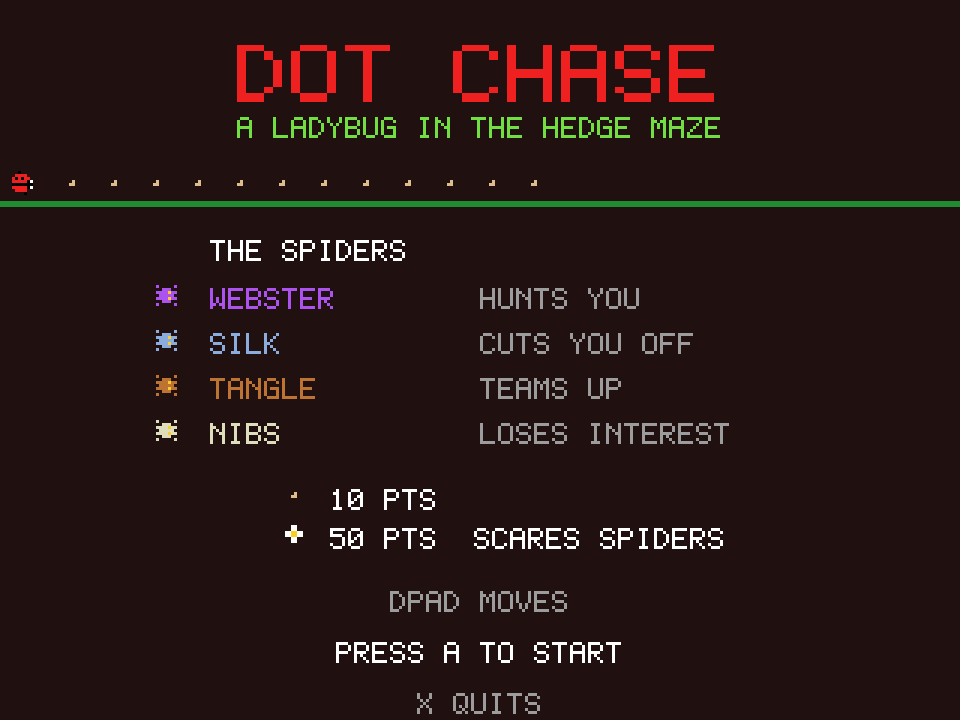

# Dot Chase
**Platform:** 3DO Interactive Multiplayer (ARM60, Portfolio OS; Opera emulator) · **Source:** `3do_dev/projects/dot_chase/` · **Type:** game

A dot-eater arcade game: a ladybug gathers seeds in a hedge maze while four spiders hunt it, and a flower turns the tables. Ported from the Amiga original (`amiga_mcp examples/dot_chase`): `game.c`, `draw.c` and `sound.c` are the Amiga sources, and `main_3do.c` replaces the AmigaOS screen, IDCMP keyboard and joystick code. The Amiga game and drawing code runs unchanged on the 3DO through `sdk/amiga`, a compatibility layer that implements graphics.library calls into an offscreen 320x256 buffer shown each frame as one MADAM cel scaled to 320x240, emulates Paula on the 3DO's DSP, and paces the game to 50 fps. Its `test.py` (built on `tdo.porttest`) boots the ISO headless in the patched Opera emulator, waits for `AMIGA3DO: ready`, presses buttons, checks the game's log lines and measures the speed from the layer's `AMIGA3DO: frame=` lines. Native framebuffer 320x240, shown here at 3x (960x720, nearest-neighbour).

## Title screen

"DOT CHASE / A LADYBUG IN THE HEDGE MAZE" in red, a ladybug trailing seeds, then THE SPIDERS: Webster (hunts you), Silk (cuts you off), Tangle (teams up) and Nibs (loses interest), the scoring (10 pts seed, 50 pts flower: scares spiders) and DPAD MOVES / PRESS A TO START / X QUITS.

## Gameplay

The green hedge maze lined with seeds, the spiders' den in the middle, the red ladybug lower left, spiders around the maze and flowers in the corners. SCORE 150, BEST 10000, BUGS with two reserve ladybugs.

**Controls:** D-pad: steer · A or P: start · X: quit to the menu
