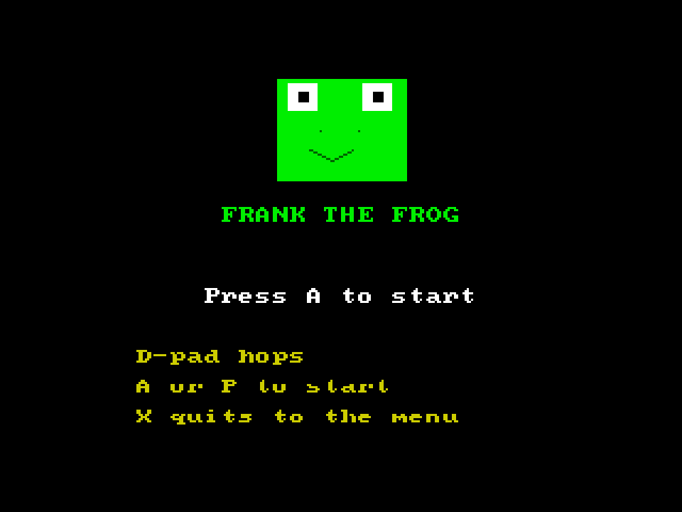
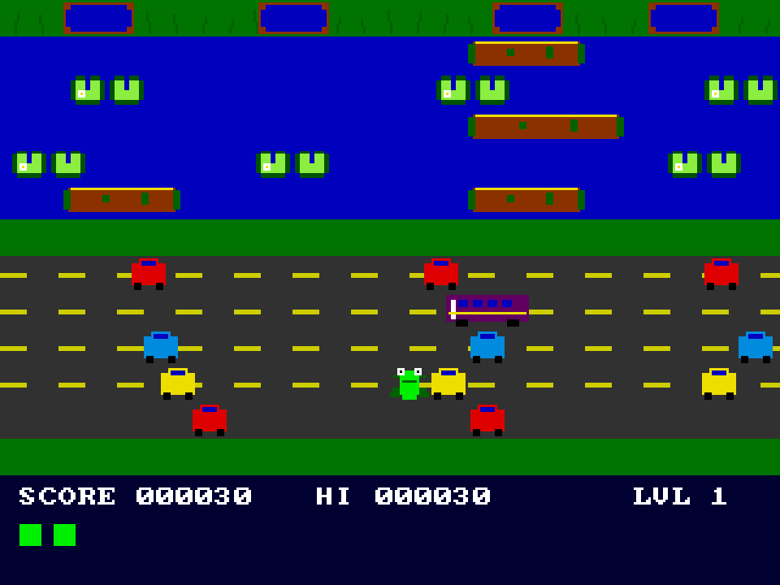

# Frank the Frog
**Platform:** 3DO Interactive Multiplayer (ARM60, Portfolio OS; Opera emulator) · **Source:** `3do_dev/projects/frank_the_frog/` · **Type:** game

A road-and-river crossing game: hop Frank through traffic and ride logs and turtles to the homes, with generated music. Ported from the Amiga original (`amiga_mcp examples/frank_the_frog`); the Amiga main loop is split into a 50 Hz `game_step()` so the layer's `gfx_steps()` keeps the game at full speed while drawing catches up (about 42 frames drawn per second). The Amiga game and drawing code runs unchanged on the 3DO through `sdk/amiga`, a compatibility layer that implements graphics.library calls into an offscreen 320x256 buffer shown each frame as one MADAM cel scaled to 320x240, emulates Paula on the 3DO's DSP, and paces the game to 50 fps. Its `test.py` (built on `tdo.porttest`) boots the ISO headless in the patched Opera emulator, waits for `AMIGA3DO: ready`, presses buttons, checks the game's log lines and measures the speed from the layer's `AMIGA3DO: frame=` lines. Native framebuffer 320x240, shown here at 3x (960x720, nearest-neighbour).

## Title screen

A big green frog face, "FRANK THE FROG", "Press A to start" and the controls in yellow: D-pad hops, A or P to start, X quits to the menu.

## Gameplay

Frank (green) mid-way across the four-lane road between red, yellow and blue cars and a purple truck; above, the blue river with brown logs and turtle pairs, and the blue home bays along the top. SCORE 000030, HI 000030, LVL 1, two lives.

**Controls:** D-pad: hop · A or P: start · X: quit to the menu
