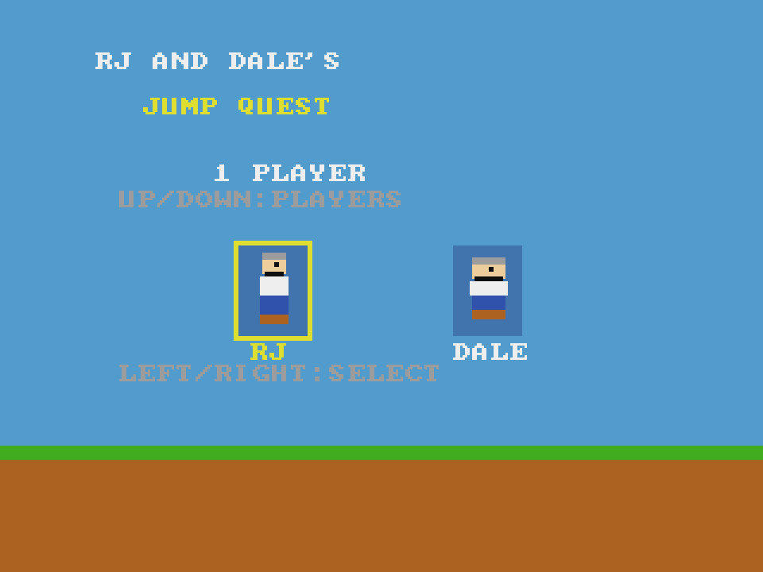

# Jump Quest
**Platform:** 3DO Interactive Multiplayer (ARM60, Portfolio OS; Opera emulator) · **Source:** `3do_dev/projects/jump_quest/` · **Type:** game

A side-scrolling platformer starring RJ and Dale for one or two players taking turns, with three levels. Ported from the Amiga original (`amiga_mcp examples/jump_quest`) with `input_3do.c` and `gfx_layer.c` added for the 3DO. The Amiga game and drawing code runs unchanged on the 3DO through `sdk/amiga`, a compatibility layer that implements graphics.library calls into an offscreen 320x256 buffer shown each frame as one MADAM cel scaled to 320x240, emulates Paula on the 3DO's DSP, and paces the game to 50 fps. Its `test.py` (built on `tdo.porttest`) boots the ISO headless in the patched Opera emulator, waits for `AMIGA3DO: ready`, presses buttons, checks the game's log lines and measures the speed from the layer's `AMIGA3DO: frame=` lines. Native framebuffer 320x240, shown here at 3x (960x720, nearest-neighbour).

## Title screen

"RJ AND DALE'S / JUMP QUEST" on a blue sky above grass and earth, "1 PLAYER" (UP/DOWN: PLAYERS) and the two characters, RJ (selected with a yellow box) and Dale, with "LEFT/RIGHT: SELECT".

## Gameplay

RJ jumping over a gap in the ground on level 1, green blob enemies on the earth, a brick block with a red gift box above, and a cloud. HUD: RJ with four hearts, SCORE 300, LIVES 3, LV 1.

**Controls:** D-pad: move · A: jump · Title: Up / Down players, Left / Right pick RJ or Dale · X: quit to the menu
