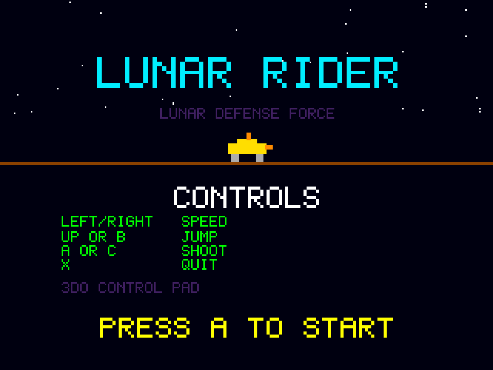

# Lunar Rider
**Platform:** 3DO Interactive Multiplayer (ARM60, Portfolio OS; Opera emulator) · **Source:** `3do_dev/projects/lunar_rider/` · **Type:** game

A side-scrolling moon-buggy ride: jump craters and rocks and shoot UFOs and meteors on the way to each checkpoint. Ported from the Amiga original (`amiga_mcp examples/lunar_rider`). The Amiga game and drawing code runs unchanged on the 3DO through `sdk/amiga`, a compatibility layer that implements graphics.library calls into an offscreen 320x256 buffer shown each frame as one MADAM cel scaled to 320x240, emulates Paula on the 3DO's DSP, and paces the game to 50 fps. Its `test.py` (built on `tdo.porttest`) boots the ISO headless in the patched Opera emulator, waits for `AMIGA3DO: ready`, presses buttons, checks the game's log lines and measures the speed from the layer's `AMIGA3DO: frame=` lines. Native framebuffer 320x240, shown here at 3x (960x720, nearest-neighbour).

## Title screen

"LUNAR RIDER / LUNAR DEFENSE FORCE" in cyan over stars, the yellow buggy on the horizon, the CONTROLS (Left/Right speed, Up or B jump, A or C shoot, X quit, 3DO control pad) and "PRESS A TO START".

## Gameplay

Zone 02: purple mountains against a starry sky over brown cratered ground with small rocks and orange shots. SCORE 1100, HI 1100, one life left and the zone progress bar.

**Controls:** Left / Right: speed · Up or B: jump · A or C: shoot · A or P: start · X: quit to the menu
