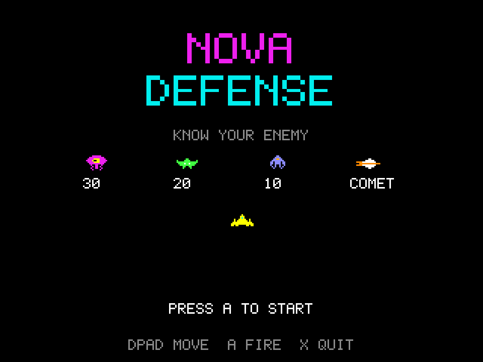

# Nova Defense
**Platform:** 3DO Interactive Multiplayer (ARM60, Portfolio OS; Opera emulator) · **Source:** `3do_dev/projects/nova_defense/` · **Type:** game

A fixed-screen alien shooter: hold back the descending swarm from behind crystal shields and pick off the comet. Ported from the Amiga original (`amiga_mcp examples/nova_defense`); the palette is the Amiga version's `LoadRGB32` table. The Amiga game and drawing code runs unchanged on the 3DO through `sdk/amiga`, a compatibility layer that implements graphics.library calls into an offscreen 320x256 buffer shown each frame as one MADAM cel scaled to 320x240, emulates Paula on the 3DO's DSP, and paces the game to 50 fps. Its `test.py` (built on `tdo.porttest`) boots the ISO headless in the patched Opera emulator, waits for `AMIGA3DO: ready`, presses buttons, checks the game's log lines and measures the speed from the layer's `AMIGA3DO: frame=` lines. Native framebuffer 320x240, shown here at 3x (960x720, nearest-neighbour).

## Title screen

"NOVA DEFENSE" in magenta and cyan, KNOW YOUR ENEMY with the three alien types (30, 20 and 10 points) and the COMET, the yellow player ship, "PRESS A TO START" and "DPAD MOVE  A FIRE  X QUIT".

## Gameplay

Wave 1: rows of magenta, green and blue aliens above three cyan crystal shields, the yellow ship at the bottom and an alien shot falling. PTS 60, BEST 60, two reserve ships.

**Controls:** Left / Right: move · A (or B / C): fire · A or P: start · X: quit to the menu
