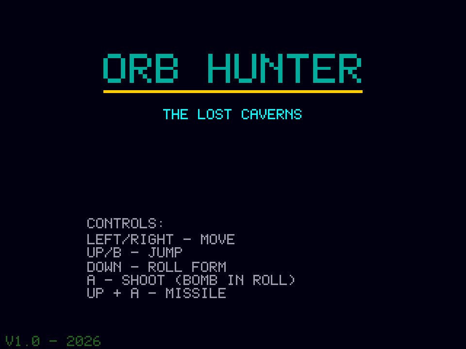
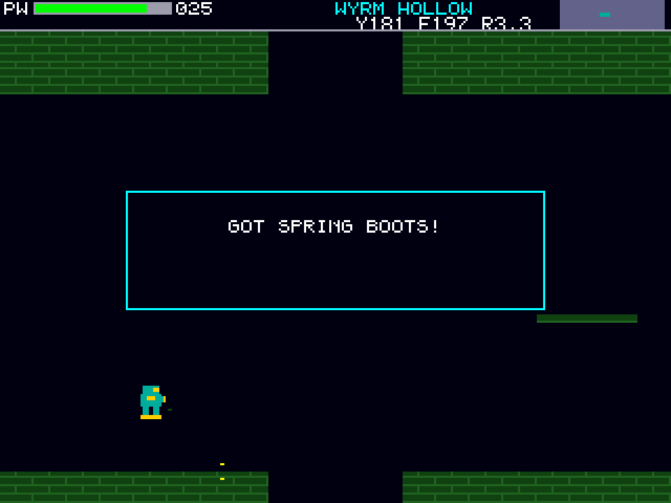
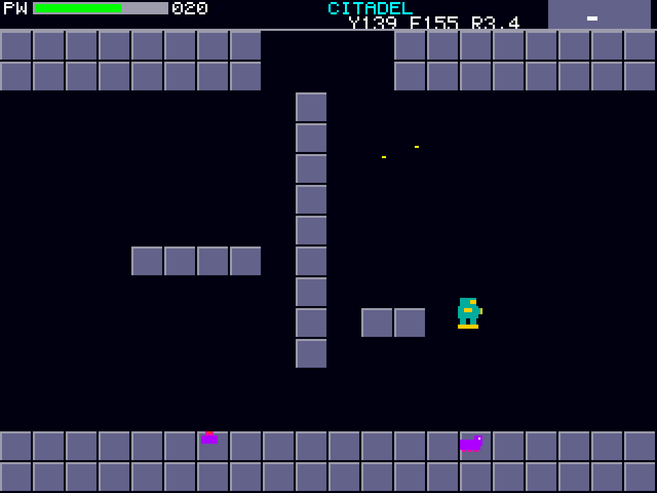

# Orb Hunter
**Platform:** 3DO Interactive Multiplayer (ARM60, Portfolio OS; Opera emulator) · **Source:** `3do_dev/projects/orb_hunter/` · **Type:** game

A cavern-exploration platformer: search the caverns room by room and collect power-ups (spring boots, roll form, missiles, bombs) to reach new areas. Ported from the Amiga original (`amiga_mcp examples/orb_hunter`); it plays `rock_blaster.mod` ("Rock Storm", an original tune generated by `tools/modgen`) through the layer's ProTracker player. The Amiga game and drawing code runs unchanged on the 3DO through `sdk/amiga`, a compatibility layer that implements graphics.library calls into an offscreen 320x256 buffer shown each frame as one MADAM cel scaled to 320x240, emulates Paula on the 3DO's DSP, and paces the game to 50 fps. Its `test.py` (built on `tdo.porttest`) boots the ISO headless in the patched Opera emulator, waits for `AMIGA3DO: ready`, presses buttons, checks the game's log lines and measures the speed from the layer's `AMIGA3DO: frame=` lines. Native framebuffer 320x240, shown here at 3x (960x720, nearest-neighbour).

## Title screen

"ORB HUNTER / THE LOST CAVERNS" in teal on a dark background with the controls: Left/Right move, Up/B jump, Down roll form, A shoot (bomb in roll), Up + A missile, and "V1.0 - 2026".

## Gameplay

Wyrm Hollow: the teal-suited hunter on a green rock ledge with a magenta creature to the right and thin green platforms above. HUD: power bar at 030, room name and coordinates, minimap.

## Power-up

A "GOT SPRING BOOTS!" message box after collecting the power-up, the hunter at lower left; the power bar has dropped to 025.

## The Citadel

Further on, the Citadel: grey-blue stone blocks and columns, the hunter on a block and magenta crawlers on the floor.

**Controls:** Left / Right: move · Up or B: jump / aim up · Down: roll form · A: fire (bombs when rolled) · Up + A: missile · A or P: start · X: quit to the menu
