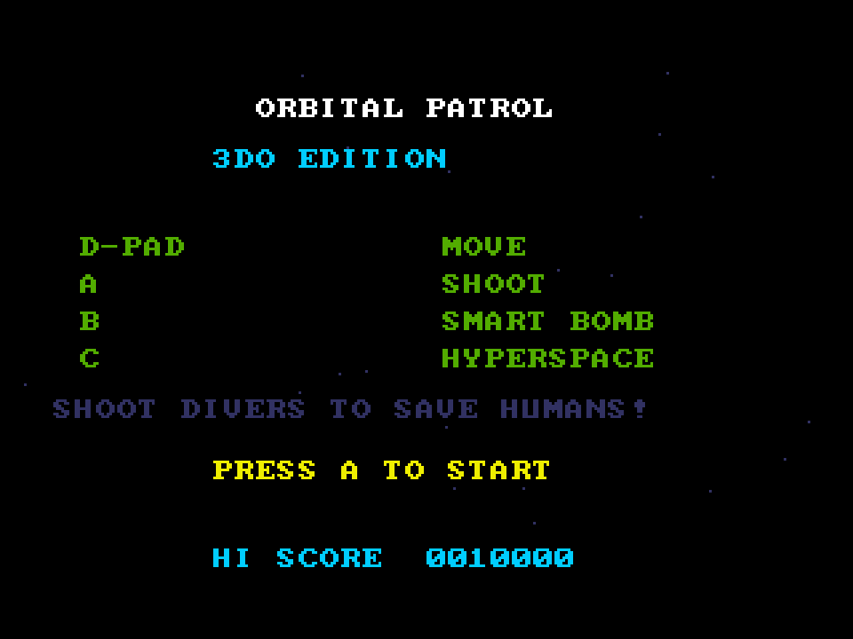

# Orbital Patrol
**Platform:** 3DO Interactive Multiplayer (ARM60, Portfolio OS; Opera emulator) · **Source:** `3do_dev/projects/orbital_patrol/` · **Type:** game

A side-scrolling planet-defence shooter: protect the humans from abductors across a wrapping world, with a scanner, smart bombs and hyperspace. Ported from the Amiga original (`amiga_mcp examples/orbital_patrol`): the state machine is copied unchanged from its `main.c`, the music is `orbital_patrol.mod` (made by `tools/modgen/orbital_patrol.py`) on the layer's ProTracker player, and high scores are saved to NVRAM. The Amiga game and drawing code runs unchanged on the 3DO through `sdk/amiga`, a compatibility layer that implements graphics.library calls into an offscreen 320x256 buffer shown each frame as one MADAM cel scaled to 320x240, emulates Paula on the 3DO's DSP, and paces the game to 50 fps. Its `test.py` (built on `tdo.porttest`) boots the ISO headless in the patched Opera emulator, waits for `AMIGA3DO: ready`, presses buttons, checks the game's log lines and measures the speed from the layer's `AMIGA3DO: frame=` lines. Native framebuffer 320x240, shown here at 3x (960x720, nearest-neighbour).

## Title screen

"ORBITAL PATROL / 3DO EDITION", the controls (D-pad move, A shoot, B smart bomb, C hyperspace), "SHOOT DIVERS TO SAVE HUMANS!", "PRESS A TO START" and HI SCORE 0010000.

## Gameplay

Flying over green rolling terrain with the scanner strip across the top, white enemies and the yellow ship. Score 0000300, HI 0010000, wave W1, H7 humans, smart bombs and ships in yellow at bottom right.

**Controls:** D-pad: fly · A: fire · B: smart bomb · C: hyperspace · A or P: start · X: quit to the menu
