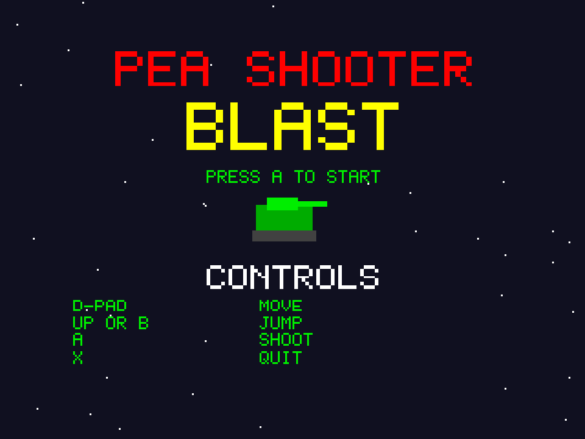

# Pea Shooter Blast
**Platform:** 3DO Interactive Multiplayer (ARM60, Portfolio OS; Opera emulator) · **Source:** `3do_dev/projects/pea_shooter_blast/` · **Type:** game

Side-scrolling tank action: drive, jump and blast through the enemy lines. Ported from the Amiga original (`amiga_mcp examples/pea_shooter_blast`), with "Pea Patrol" (`music.mod`, generated by `tools/modgen`) on the layer's ProTracker player. The scrolled background is kept in a tile cache drawn as its own hardware cel under the game's frame (`gfx_layer_cel()` / `gfx_set_underlay()`). The Amiga game and drawing code runs unchanged on the 3DO through `sdk/amiga`, a compatibility layer that implements graphics.library calls into an offscreen 320x256 buffer shown each frame as one MADAM cel scaled to 320x240, emulates Paula on the 3DO's DSP, and paces the game to 50 fps. Its `test.py` (built on `tdo.porttest`) boots the ISO headless in the patched Opera emulator, waits for `AMIGA3DO: ready`, presses buttons, checks the game's log lines and measures the speed from the layer's `AMIGA3DO: frame=` lines. Native framebuffer 320x240, shown here at 3x (960x720, nearest-neighbour).

## Title screen

"PEA SHOOTER / BLAST" in red and yellow over stars, "PRESS A TO START", the green tank and the CONTROLS: D-pad move, Up or B jump, A shoot, X quit.

## Gameplay

Level 1: the green tank on the left firing a stream of yellow peas toward a red enemy on the right, a red spike pit in the brown ground and brown ledges above. HUD: HP bar, GUN 1, score 200, LV1.

**Controls:** Left / Right: drive · Up or B: jump · Down: crouch · A: fire (and start) · X: quit to the menu
