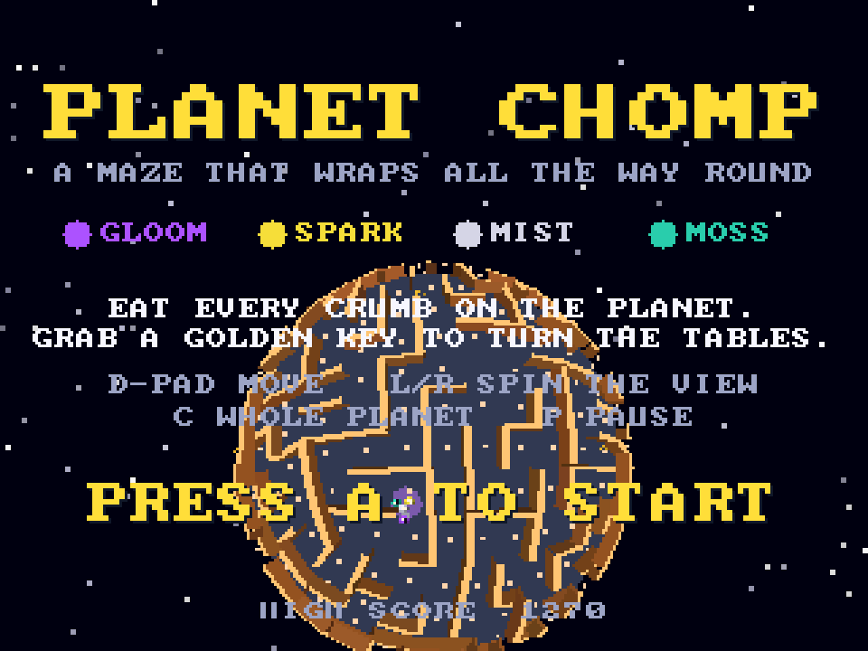
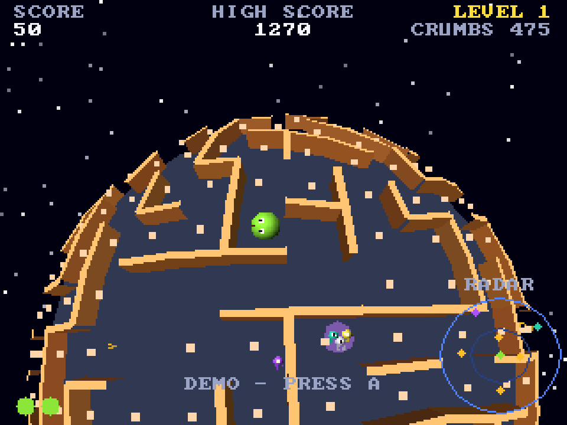

# Planet Chomp
**Platform:** 3DO Interactive Multiplayer (ARM60, Portfolio OS; Opera emulator) · **Source:** `3do_dev/projects/planet_chomp/` · **Type:** game

A maze chase on a tiny planet: the maze wraps all the way round a sphere, and you eat every crumb while four spooks (Gloom, Spark, Mist and Moss) hunt you, grabbing a golden key to turn the tables. It is a rewrite for the 3DO of a Unity (C#) game, not an Amiga port; the classic 68k Amiga build in this portfolio (`planet_chomp_68k`) runs this 3DO code with a software cel renderer. The cube-sphere maze, camera and spook AI are rewritten in C89 with fixed-point maths; walls are flat-shaded quads drawn as MADAM cels (one texel mapped onto four corners), projected with a reciprocal table and bucket depth-sorted, about 120 walls and 400 cels a frame at roughly 14 fps while the logic runs at 50 steps per second. Sounds are synthesised at startup and played on the DSP. Its `test.py` plays it headless, including the attract-mode autopilot. Native framebuffer 320x240, shown here at 3x (960x720, nearest-neighbour).

## Title screen

"PLANET CHOMP / A MAZE THAT WRAPS ALL THE WAY ROUND", the four spooks (Gloom, Spark, Mist, Moss), the rules and controls over a dim planet, "PRESS A TO START" and the high score 1270.

## Gameplay

The orange-walled maze curving over the dark-blue planet, crumbs along the paths, the green chomper and the yellow golden key nearby, and the radar circle at bottom right. SCORE 110, HIGH SCORE 1270, LEVEL 1, CRUMBS 469, two lives.

## Attract mode

Left alone on the title, the autopilot (ported from the Unity bot) plays: the chomper and a purple spook on the planet, "DEMO - PRESS A" across the bottom, CRUMBS 475.

**Controls:** D-pad: steer (relative to the screen) · L / R: spin the view · C: whole-planet view · P: pause · A: start · X: quit to the menu
