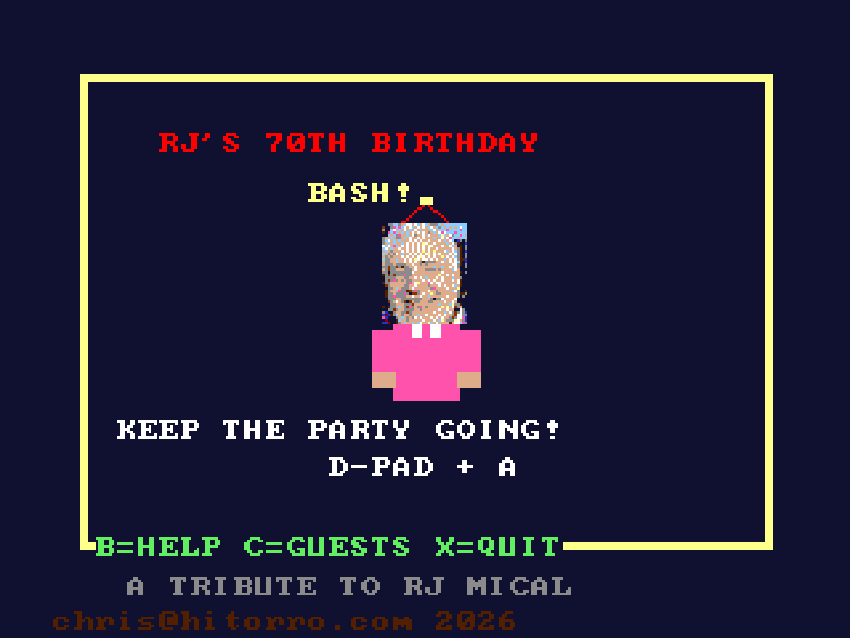

# RJ's Birthday Bash
**Platform:** 3DO Interactive Multiplayer (ARM60, Portfolio OS; Opera emulator) · **Source:** `3do_dev/projects/rj_birthday/` · **Type:** game

An arcade party game written as a tribute to RJ Mical (Intuition, Amiga, Atari Lynx, 3DO) for his 70th birthday: run the party across six themed rooms of RJ's house. Ported from the Amiga original (`amiga_mcp examples/rj_birthday`) with tracker music; each room's background is drawn once into its own buffer and shown as a hardware cel under the frame (`gfx_layer_cel()` in `rooms.c`). The Amiga game and drawing code runs unchanged on the 3DO through `sdk/amiga`, a compatibility layer that implements graphics.library calls into an offscreen 320x256 buffer shown each frame as one MADAM cel scaled to 320x240, emulates Paula on the 3DO's DSP, and paces the game to 50 fps. Its `test.py` (built on `tdo.porttest`) boots the ISO headless in the patched Opera emulator, waits for `AMIGA3DO: ready`, presses buttons, checks the game's log lines and measures the speed from the layer's `AMIGA3DO: frame=` lines. Native framebuffer 320x240, shown here at 3x (960x720, nearest-neighbour).

## Title screen

A yellow frame with "RJ'S 70TH BIRTHDAY BASH!", a pixel portrait of RJ in a pink shirt, "KEEP THE PARTY GOING! D-PAD + A", "B=HELP C=GUESTS X=QUIT" and "A TRIBUTE TO RJ MICAL".

## Gameplay

The Amsterdam Lounge: RJ by a tall blue window with a yellow balloon, a gift on the floor, and a green Coffee Shop wall at right. SCORE: 0, three red party hats and the clock at 7:10.

**Controls:** D-pad: move · A: act · B: help · C: guest list · X: back · Names: A adds a letter, Up / Down change it, B deletes, P confirms
