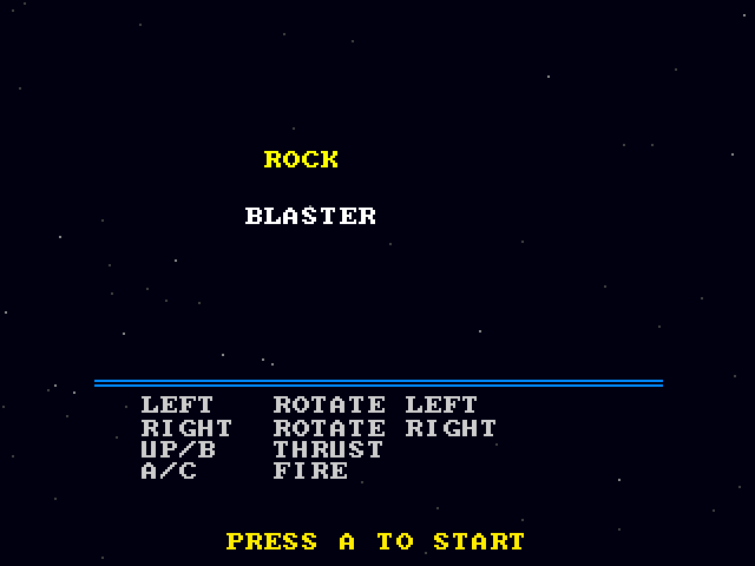

# Rock Blaster
**Platform:** 3DO Interactive Multiplayer (ARM60, Portfolio OS; Opera emulator) · **Source:** `3do_dev/projects/rock_blaster/` · **Type:** game

A vector rock shooter: rotate, thrust and blast drifting rocks that split as they are hit. Ported from the Amiga original (`amiga_mcp examples/rock_blaster`): `game.c` and `draw.c` are the unmodified Amiga sources, and `main_3do.c` holds the palette, the procedural sound effects copied from the original and the main loop. The Amiga game and drawing code runs unchanged on the 3DO through `sdk/amiga`, a compatibility layer that implements graphics.library calls into an offscreen 320x256 buffer shown each frame as one MADAM cel scaled to 320x240, emulates Paula on the 3DO's DSP, and paces the game to 50 fps. Its `test.py` (built on `tdo.porttest`) boots the ISO headless in the patched Opera emulator, waits for `AMIGA3DO: ready`, presses buttons, checks the game's log lines and measures the speed from the layer's `AMIGA3DO: frame=` lines. Native framebuffer 320x240, shown here at 3x (960x720, nearest-neighbour).

## Title screen

"ROCK / BLASTER" in yellow and white over stars, a blue rule, the controls (Left/Right rotate, Up/B thrust, A/C fire) and "PRESS A TO START".

## Gameplay

The white vector ship among outlined rocks of three sizes, a rock breaking up beside it. Score 0000210, three reserve ships, level L1.

**Controls:** Left / Right: rotate · Up or B: thrust · A or C: fire · P: start · X: quit to the menu
