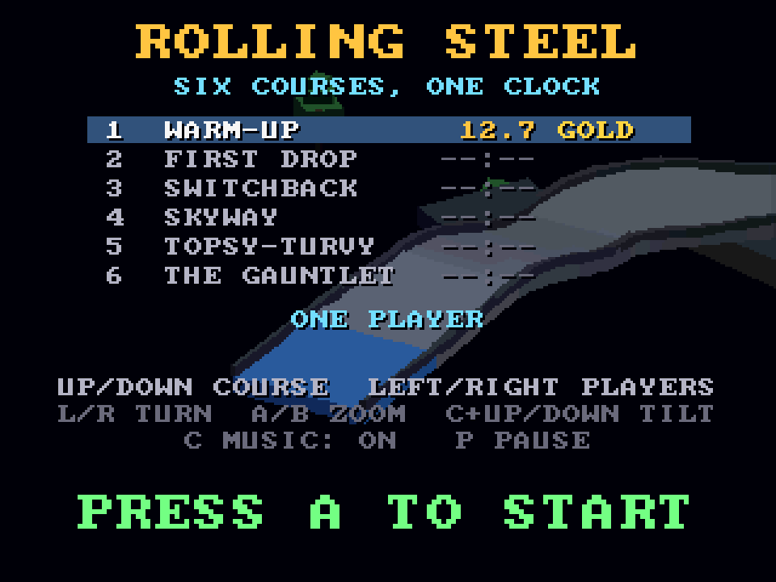
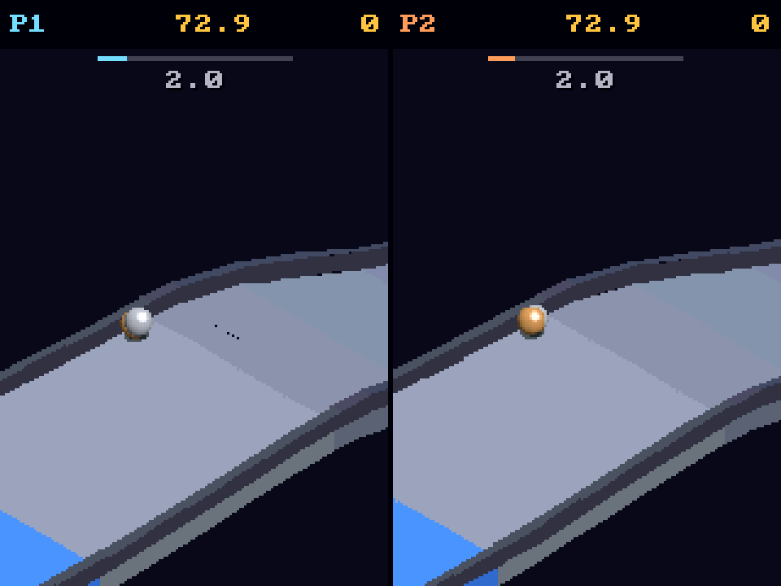

# Rolling Steel
**Platform:** 3DO Interactive Multiplayer (ARM60, Portfolio OS; Opera emulator) · **Source:** `3do_dev/projects/rolling_steel/` · **Type:** game

A marble racer over six floating courses against one clock that carries over, in the spirit of the 1984 arcade cabinet. A rewrite for the 3DO of a Unity (C#) game (the classic 68k Amiga build in this portfolio, `rolling_steel_68k`, runs this 3DO code with a software rasteriser): the courses are built from the Unity game's own course files by `tools/courses.py`, the marble is a spinning sphere with Coulomb friction against the course triangles in Q12 fixed point at 50 Hz (`src/phys.c`), and the orthographic view at any yaw, pitch and zoom draws faces as flat cel quads bucket-sorted by depth, with shadows darkening the framebuffer through the cel's pixel processor. Best times live in NVRAM. Its `test.py` also runs an autopilot through all six courses on the host. Native framebuffer 320x240, shown here at 3x (960x720, nearest-neighbour).

## Title screen

"ROLLING STEEL / SIX COURSES, ONE CLOCK" with the course list (1 Warm-Up, gold 12.7; First Drop, Switchback, Skyway, Topsy-Turvy, The Gauntlet), "ONE PLAYER", the controls and "PRESS A TO START" over a course in the background.

## Gameplay

Course 1/6 Warm-Up: the steel marble rolling on a pale-blue track past a grey pillar, a green cube and a tree. Clock 69.0, FALLS 0, split 6.0 against BEST 12.7.

## Two players

Two players on two pads in split screen: P1's steel marble and P2's bronze marble on the same course, each with clock 72.9 and 0 falls.

**Controls:** D-pad: push the marble (relative to the view) · L / R: turn the view · A / B: zoom · C + Up / Down: tilt · P: pause · X: back to the menu · Title: Up / Down course, Left / Right players
