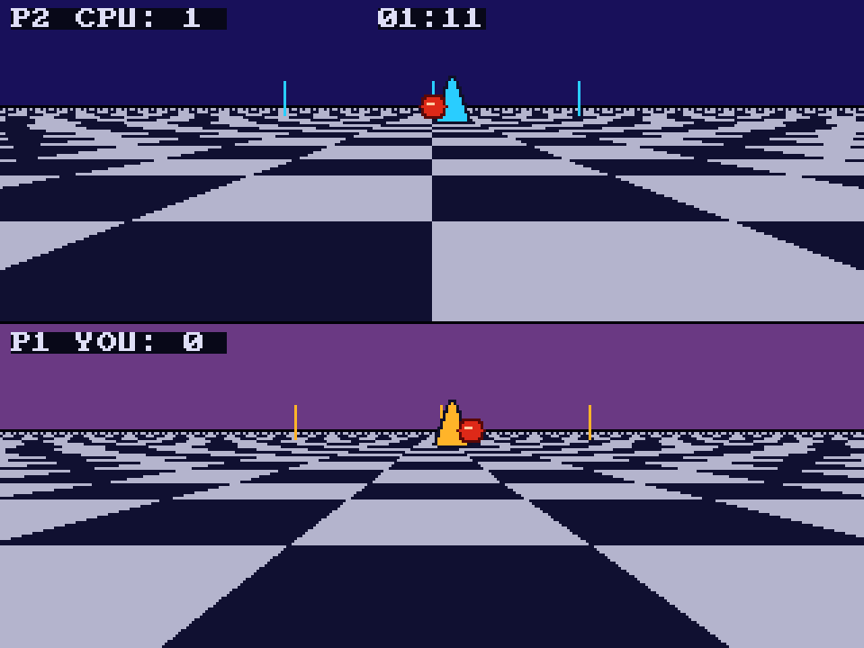

# Rotoball
**Platform:** 3DO Interactive Multiplayer (ARM60, Portfolio OS; Opera emulator) · **Source:** `3do_dev/projects/rotoball/` · **Type:** game

A split-screen futuristic ball sport in the style of Ballblazer: the top pane shows the CPU opponent's view and the bottom pane the player's, each skimmer facing the ball. Ported from the Amiga original (`amiga_mcp examples/rotoball`). The chequered floor is drawn by the cel engine: one cel per band of screen rows maps a single row of alternating texels onto the trapezoid between the band's edges (HDX at the top, HDX + HDDX at the bottom), about 40 cels per pane under the game's frame (`floor_cels.c`). It runs its logic at 49 steps per second while drawing about 29 frames. The game starts straight into a match, so there is no title screen. Its `test.py` checks for `BALL: score=0:0` and drives the skimmer. Native framebuffer 320x240, shown here at 3x (960x720, nearest-neighbour).

## Gameplay

Early in a match: in the top pane (P2 CPU: 0, *BALL*, 01:25) the CPU has the big red ball right in front of it; in the bottom pane (P1 YOU: 0) the player looks down the purple-sky, blue-and-white chequered pitch at the CPU's yellow skimmer carrying the ball, goal posts behind it.

## Gameplay: after a goal

Later: CPU 1, 01:11 on the clock; both panes show a skimmer and the red ball in the distance near the goal posts.

**Controls:** Up or A: forward · Down or B: reverse · Left / Right: strafe · X: quit to the menu
