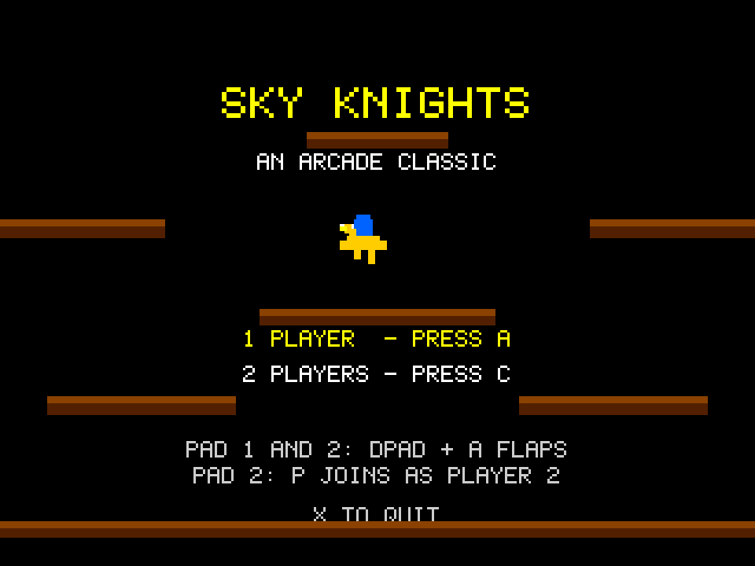

# Sky Knights
**Platform:** 3DO Interactive Multiplayer (ARM60, Portfolio OS; Opera emulator) · **Source:** `3do_dev/projects/sky_knights/` · **Type:** game

Aerial jousting on winged mounts for one or two players: strike opponents from above and collect the eggs. Ported from the Amiga original (`amiga_mcp examples/sky_knights`); pad 1 takes the Amiga keyboard's player and pad 2 the joystick's, and the flap and smash samples load from the disc. The Amiga game and drawing code runs unchanged on the 3DO through `sdk/amiga`, a compatibility layer that implements graphics.library calls into an offscreen 320x256 buffer shown each frame as one MADAM cel scaled to 320x240, emulates Paula on the 3DO's DSP, and paces the game to 50 fps. Its `test.py` (built on `tdo.porttest`) boots the ISO headless in the patched Opera emulator, waits for `AMIGA3DO: ready`, presses buttons, checks the game's log lines and measures the speed from the layer's `AMIGA3DO: frame=` lines. Native framebuffer 320x240, shown here at 3x (960x720, nearest-neighbour).

## Title screen

"SKY KNIGHTS / AN ARCADE CLASSIC" in yellow among brown ledges, the yellow-and-blue mount, "1 PLAYER - PRESS A", "2 PLAYERS - PRESS C" and the controls for both pads.

## Gameplay

Wave 1: the player's mount and two orange enemy riders on the sandy ground beneath five brown floating ledges. P1 0000750, P2 0000000.

**Controls:** D-pad: steer · A (or B / C / Up): flap · Title: A one player, C two players (P on pad 2 joins) · X: quit to the menu
