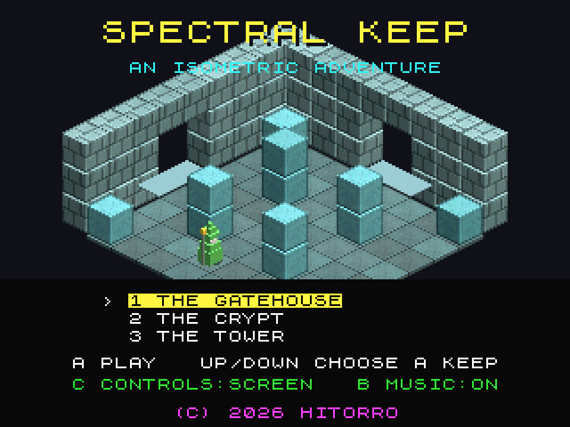
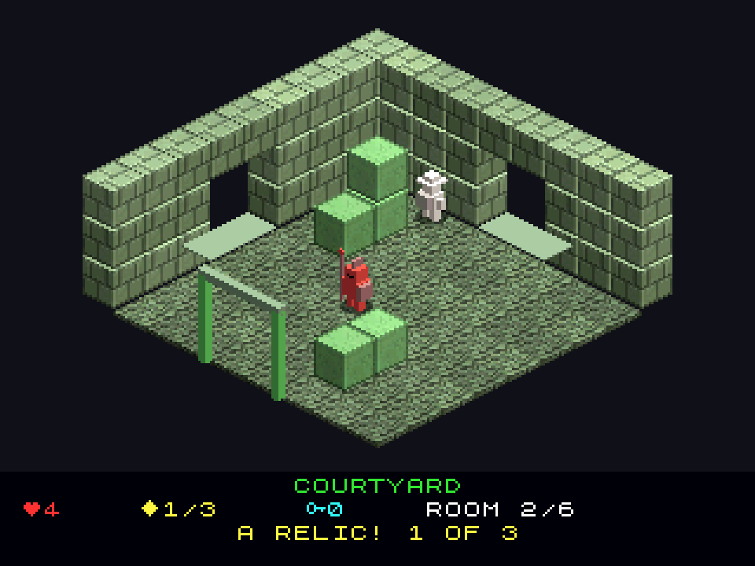

# Spectral Keep
**Platform:** 3DO Interactive Multiplayer (ARM60, Portfolio OS; Opera emulator) · **Source:** `3do_dev/projects/spectral_keep/` · **Type:** game

An isometric flip-screen adventure in the style of Knight Lore and Head over Heels: three keeps and 24 rooms, carrying relics to the throne. A rewrite for the 3DO of a Unity (C#) game that follows the C# rules line by line in C89 with Q12 fixed point; the 3D is drawn the way the 8-bit originals did it, with characters pre-rendered at startup by a small z-buffered software rasteriser (8 facings, 3 walk frames) and each room assembled as a dependency-sorted cel list, with shadows as cels whose pixel processor darkens the framebuffer. Music is rendered offline and streamed through the Amiga layer's Paula on the DSP. Its `test.py` runs the logic scenarios on the host (`tools/sim.c`), then plays the real game in the emulator: talk to the sage, walk to the courtyard and collect its relic. Native framebuffer 320x240, shown here at 3x (960x720, nearest-neighbour).

## Title screen

"SPECTRAL KEEP / AN ISOMETRIC ADVENTURE" above a teal stone room with a green figure, the keep list (1 The Gatehouse highlighted, 2 The Crypt, 3 The Tower), "A PLAY UP/DOWN CHOOSE A KEEP", "C CONTROLS:SCREEN B MUSIC:ON" and "(C) 2026 HITORRO".

## Gameplay: the courtyard

The Courtyard (room 2/6): mossy green walls and stacked blocks, a red guard by the gate and the white explorer, with a relic glinting on top of the block stack. Panel: 4 lives, 0/3 relics, 0 keys, and "WELCOME, EXPLORER! FIND THREE RELICS AND BRING THEM TO THE THRONE."

## Gameplay: a relic

The same room after climbing the block stair: the explorer stands on the top block, the relic count is 1/3 and the panel reads "A RELIC! 1 OF 3".

**Controls:** D-pad: walk (relative to the screen) · A or B: jump · P: pause · X: back to the menu · Title: Up / Down choose a keep, C grid controls, B music, L+R a tour of every room
