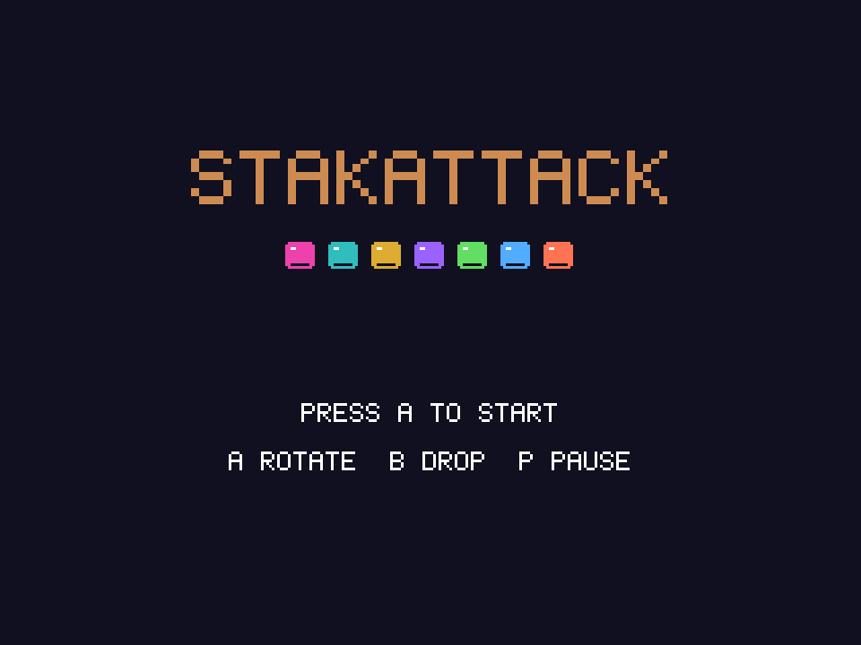
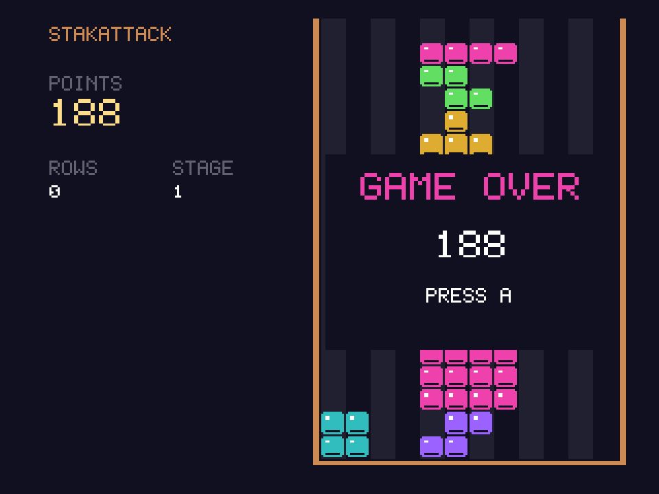

# StakAttack
**Platform:** 3DO Interactive Multiplayer (ARM60, Portfolio OS; Opera emulator) · **Source:** `3do_dev/projects/stakattack/` · **Type:** game

A colourful falling-block puzzle in a 12-wide well with original tracker music. Ported from the Amiga original (`amiga_mcp examples/stakattack`): `stakattack.mod` (made by `tools/modgen/stakattack.py`) plays on the layer's C ProTracker player and the effects are generated exactly as in the Amiga `main.c`. The Amiga game and drawing code runs unchanged on the 3DO through `sdk/amiga`, a compatibility layer that implements graphics.library calls into an offscreen 320x256 buffer shown each frame as one MADAM cel scaled to 320x240, emulates Paula on the 3DO's DSP, and paces the game to 50 fps. Its `test.py` (built on `tdo.porttest`) boots the ISO headless in the patched Opera emulator, waits for `AMIGA3DO: ready`, presses buttons, checks the game's log lines and measures the speed from the layer's `AMIGA3DO: frame=` lines. It plays until the stack tops out. Native framebuffer 320x240, shown here at 3x (960x720, nearest-neighbour).

## Title screen

"STAKATTACK" in orange over a row of seven coloured blocks, "PRESS A TO START" and "A ROTATE B DROP P PAUSE".

## Gameplay

Stage 1 in progress: magenta, cyan and purple pieces stacked at the right of the orange-framed well, a vertical magenta bar falling. POINTS 62, ROWS 0, STAGE 1, and a green piece COMING UP.

## Game over

After hard-dropping pieces until the stack reached the top: "GAME OVER / 188 / PRESS A" over the full well, POINTS 188.

**Controls:** Left / Right: move · Down: soft drop · A or Up: rotate · B or C: hard drop · P: start / pause · X: quit to the menu
