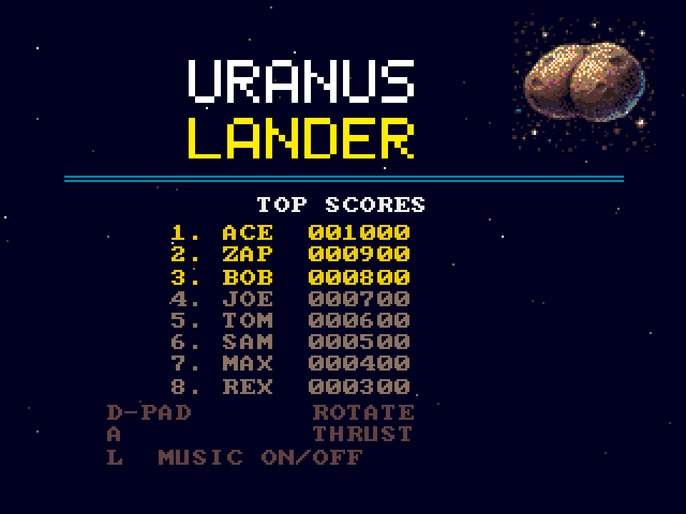

# Uranus Lander
**Platform:** 3DO Interactive Multiplayer (ARM60, Portfolio OS; Opera emulator) · **Source:** `3do_dev/projects/uranus_lander/` · **Type:** game

A lunar-lander game: rotate and thrust down onto the landing pads of procedurally generated terrain before the fuel runs out, with ProTracker music. Ported from the Amiga original (`amiga_mcp examples/uranus_lander`); the terrain is drawn once into its own buffer and shown as a hardware cel under the frame (`gfx_layer_cel()` / `gfx_set_underlay()` in `draw.c`), and the high-score table is saved to NVRAM. The Amiga game and drawing code runs unchanged on the 3DO through `sdk/amiga`, a compatibility layer that implements graphics.library calls into an offscreen 320x256 buffer shown each frame as one MADAM cel scaled to 320x240, emulates Paula on the 3DO's DSP, and paces the game to 50 fps. Its `test.py` (built on `tdo.porttest`) boots the ISO headless in the patched Opera emulator, waits for `AMIGA3DO: ready`, presses buttons, checks the game's log lines and measures the speed from the layer's `AMIGA3DO: frame=` lines. Native framebuffer 320x240, shown here at 3x (960x720, nearest-neighbour).

## Title screen

"URANUS / LANDER" in white and yellow, the cratered double-lobed planet at top right, the TOP SCORES table (ACE 001000 down to REX 000300) and the controls: D-pad rotate, A thrust, L music on/off.

## Gameplay

Level 1: the cyan lander, its thrust flame lit, high above jagged brown terrain with yellow landing pads marked x1, x1, x2 and x2. HUD: score 0000000, FUEL bar, LVL 1, three reserve landers, ALT:165, H:0, V:-4.

**Controls:** D-pad Left / Right: rotate · A: thrust (and start) · L: music on / off · X: quit to the menu
