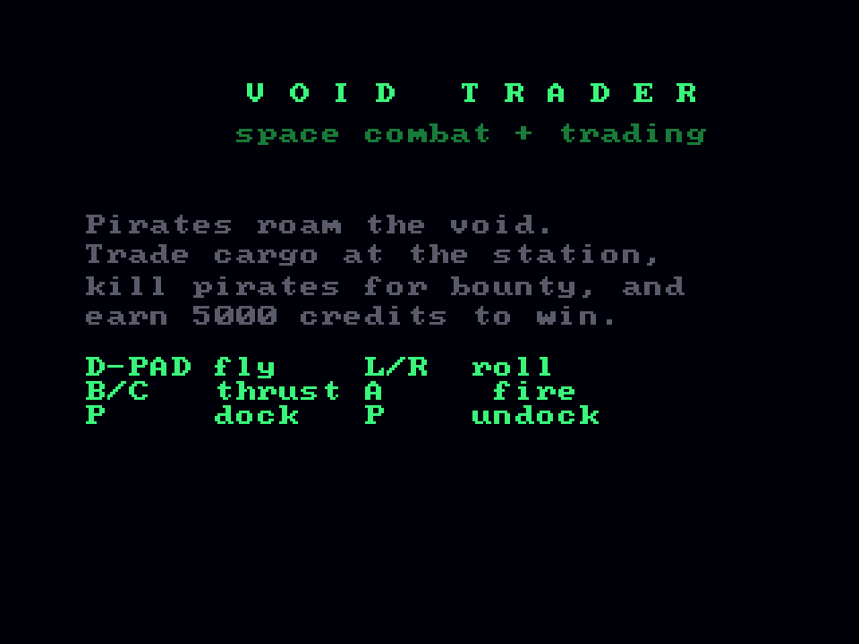
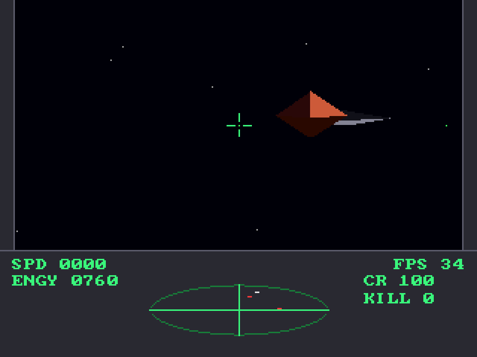

# Void Trader
**Platform:** 3DO Interactive Multiplayer (ARM60, Portfolio OS; Opera emulator) · **Source:** `3do_dev/projects/void_trader/` · **Type:** game

Space combat and trading in filled 3D: fly with six degrees of freedom, fight pirates, dock at the station to trade and earn 5000 credits to win. Ported from the Amiga original (`amiga_mcp examples/void_trader`). On the 3DO each shaded triangle is a MADAM cel of one texel mapped onto a quadrilateral whose last two corners coincide (A, B, C, C), so `engine3d.c` only swaps the Amiga's `AreaMove/AreaDraw/AreaEnd` for `tc_tri()`, and the triangles are drawn over a space-and-stars layer in painter's order (`tri_cels.c`). The logic keeps 50 steps per second while drawing about 20–34 frames. Its `test.py` starts a flight, thrusts, turns and fires, and measures the speed. Native framebuffer 320x240, shown here at 3x (960x720, nearest-neighbour).

## Title screen

"VOID TRADER / space combat + trading" in green, the briefing "Pirates roam the void. Trade cargo at the station, kill pirates for bounty, and earn 5000 credits to win." and the controls (D-pad fly, L/R roll, B/C thrust, A fire, P dock / undock).

## Gameplay

Just after launch: the green cube station in the gunsight with two red-orange pirate ships either side. Cockpit panel: SPD 0000, ENGY 0640, FPS 21, CR 100, KILL 0, and the elliptical scanner.

## Gameplay: pirate in the sights

A pirate ship with its grey exhaust trail just right of the gunsight. FPS 34, ENGY 0760.

**Controls:** D-pad: pitch / yaw · L / R: roll · B / C: thrust · A: fire · P: dock / launch · Docked: Up / Down pick, B buy, C sell · X: quit to the menu
