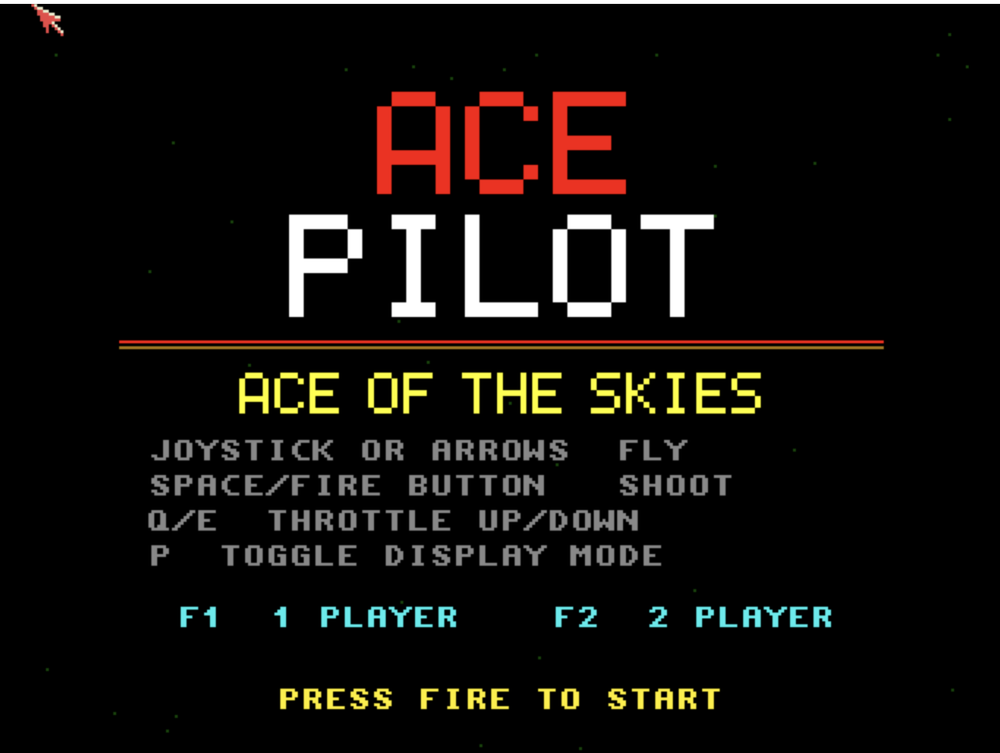

# Ace Pilot
**Platform:** Classic Amiga (68k, AGA A1200/A4000 class) · **Source:** `examples/ace_pilot/` · **Type:** game

A first-person 3D wireframe dogfighting game against enemy biplanes and blimps, with ground targets, a split-screen two-player mode and two display modes (classic green vectors or multi-colour). The 3D engine uses fixed-point maths with a precomputed 256-entry sine table, renders to a double-buffered 16-colour screen, and plays `blue_danube.mod` through ptplayer. It was built to be tuned live from DevBench: as the `ace_pilot` client it exposes tunables (`enemy_speed`, `enemy_accuracy`, `enemy_fire_rate`, `spawn_rate`, `difficulty`, `start_lives`, `player_speed`, `god_mode`, `invert_pitch` and more) and live state (`score_p1`, `lives_p1`, `wave`, `enemies`, `state`), with `reset`, `next_wave`, `toggle_display`, `status` and `set_difficulty` hooks.

## Title screen

"ACE PILOT / ACE OF THE SKIES" with the control list, F1 1 PLAYER, F2 2 PLAYER and PRESS FIRE TO START.

## Gameplay

The cockpit view: a green 3D wireframe ground grid with a runway converging to the horizon, orange ground targets and a white gunsight crosshair. The HUD shows score 000000, three plane icons, W1, ALT:300 and SPD:8.

**Controls:** Cursor keys / WASD or joystick: fly. Space, left Alt or fire: shoot. Q / E: throttle up / down. Title: F1 one player, F2 two players, P display mode, fire / Space start. Esc: back to the title (Esc on the title quits).
