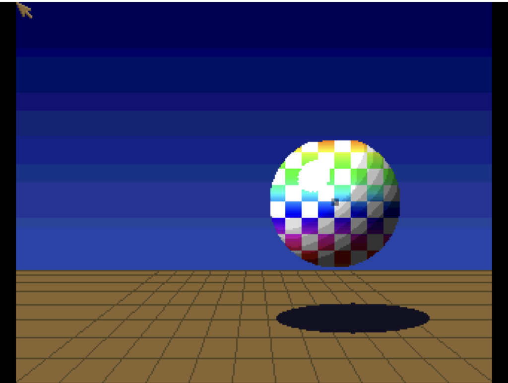

# Boing Ball
**Platform:** Classic Amiga (68k, AGA A1200/A4000 class) · **Source:** `examples/boing_ball/` · **Type:** demo

A modern take on the classic Amiga Boing Ball demo: a lit red/white checkered sphere (light from the upper-left-front) bouncing over a perspective grid floor with a depth-scaled shadow, a copper-gradient sky, squash/stretch bounce physics and a synthesised metallic clank. It runs on a 320x256, 5-bitplane (32-colour) screen for a 68020. It registers with the bridge as `boing_ball`, exposing `frame`, `ball_x` and `ball_y`, and logs start/shutdown.

## Running

The red/white checkered sphere bounces above a brown perspective grid floor, its dark elliptical shadow beneath it, under a blue banded copper sky.

## Rainbow copper mode

After pressing C (rainbow copper), the ball's checks show rainbow bands (yellow, green, blue, purple, red); the ball is lower and nearer, with a larger shadow.

**Controls:** Space credits, C rainbow copper on/off, F / S faster / slower, Esc quit.
