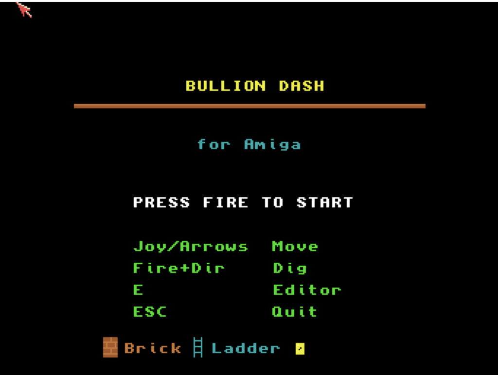

# Bullion Dash
**Platform:** Classic Amiga (68k, AGA A1200/A4000 class) · **Source:** `examples/bullion_dash/` · **Type:** game

A puzzle platformer: collect all the gold, dig traps for the guards and escape, with a built-in level editor (E on the title). It uses a 16-colour custom screen double-buffered via ScreenBuffer, and its music comes from its own MOD-style player that drives Paula directly from a VBlank tick, with one channel reserved for sound effects. As the `bullion_dash` bridge client it exposes `score`, `lives`, `level`, `gold`, `game_state`, `player_gx` and `player_gy`, registers `status`, `reset` and `goto_level` hooks, and logs game events (level start and completion, player caught, game over) with `AB_I`.

## Title screen

"BULLION DASH for Amiga" with PRESS FIRE TO START, the controls (joystick/arrows move, fire + direction dig, E editor, Esc quit) and a legend of the tiles (brick, ladder, gold).

## Gameplay

Level 1: brick platforms, cyan ladders, yellow gold bars and a grey solid floor, with the player and a red guard on the floor. HUD: SCORE 000000, LV:1, GOLD:0/5, LIVES:5. (The editor was not captured: placing tiles needs joystick fire.)

**Controls:** Cursor keys or joystick: run and climb. Hold Space / Return / fire + left or right: dig. Space, Return or fire: start; E: editor; Esc: quit. Editor: cursor/joystick move, fire place, Space next tile, 1-0 pick tile, F1 save, F2 load, F3 test play.
