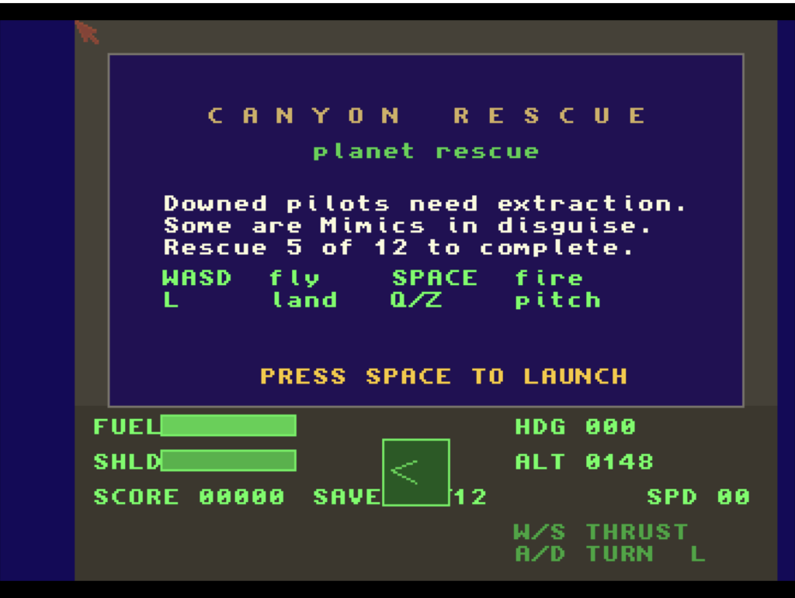

# Canyon Rescue
**Platform:** Classic Amiga (68k, AGA A1200/A4000 class) · **Source:** `examples/canyon_rescue/` · **Type:** game

Fly the valleys of a fractal planet and rescue downed pilots, some of whom are Mimics in disguise. Written in C++ (no exceptions/RTTI/STL) for a 256-colour AGA 320x256 screen, it generates a wraparound heightfield by midpoint displacement and draws it with a column-by-column voxel-space renderer that fills bitplanes directly, double buffered with `ChangeScreenBuffer`; the soundtrack is a generated heavy-metal track from a Paula-direct MOD-style player, with effects on channel 3. It goes into an attract demo after about 5 seconds idle on the title. It registers as `canyon_rescue` with many live variables (`ship_x/y/z`, `ship_yaw`, `ship_pitch`, `ship_speed`, `fuel`, `shield`, `score`, `pilots_saved`, `pilots_lost`, `rescue_state`, `seed`, `mode`, `frame_count`) and debug switches such as `debug_all_mimics`, `bench_mask` and `force_restart`.

## Title screen

A cockpit frame showing the "CANYON RESCUE / planet rescue" briefing ("Downed pilots need extraction. Some are Mimics in disguise. Rescue 5 of 12 to complete.") with key help, above the instrument panel: FUEL, SHLD, SCORE, SAVE ?12, HDG, ALT, SPD and a compass.

## Gameplay

A first-person view over the fractal landscape: a banded sunset sky from purple to orange above green and olive terrain with ridges. The instruments read HDG 000, ALT 0454, SPD 32.

**Controls:** A/D or cursor left/right: turn · W/up: thrust · S/down: brake · Q / Z: pitch · Space: fire / start · L: land · Return: restart after a mission · Esc: quit (keyboard only)
