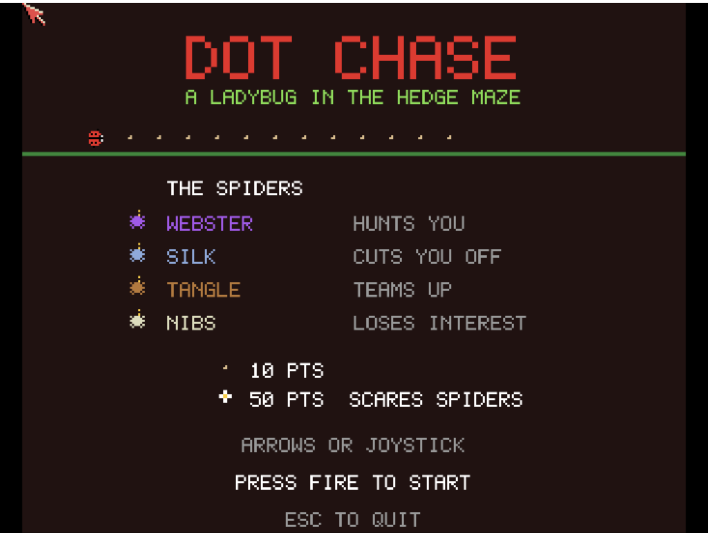

# Dot Chase
**Platform:** Classic Amiga (68k, AGA A1200/A4000 class) · **Source:** `examples/dot_chase/` · **Type:** game

A dot-eater arcade game: a ladybug gathers seeds in a hedge maze while four spiders hunt it, and a flower turns the tables; it supports alternating two-player play. Sound is driven directly on Paula's four channels: pentatonic seed pips, effects, cricket chirps that quicken as the garden empties, and a bubbling arpeggio while the spiders are scared. The screen is double buffered at 16 colours (`ChangeScreenBuffer`), and the game registers as `dot_chase` with `score`, `lives`, `level` and `state` variables plus `reset` and `status` hooks.

## Title screen

"DOT CHASE / A LADYBUG IN THE HEDGE MAZE" introduces the four spiders (WEBSTER hunts you, SILK cuts you off, TANGLE teams up, NIBS loses interest), 10-point crumbs and the 50-point flower that "scares spiders", with PRESS FIRE TO START.

## Gameplay

The red ladybug is in the middle of a green hedge maze of seed dots, with a purple spider just above it, a blue spider top right and two spiders still in the central pen; flower power-ups sit in the corners and a bonus item to the right. The HUD shows SCORE 160, BEST 10000 and two lives.

**Controls:** Cursor keys / WASD or joystick: move · Space, Return, F1 or fire: start · Esc: quit
