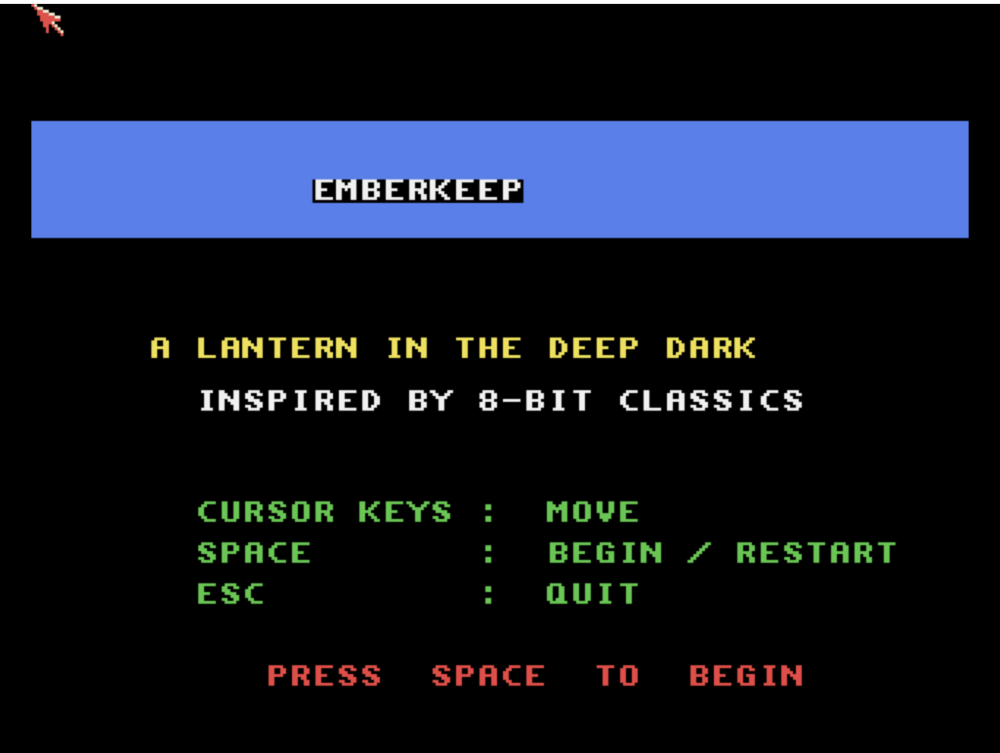

# Emberkeep
**Platform:** Classic Amiga (68k, AGA A1200/A4000 class) · **Source:** `examples/emberkeep/` · **Type:** game

A clean-room top-down cavern explorer played by lantern light: only a small area around the player is lit, the lantern burns oil that must be refilled from flasks, and collecting the runes opens the exit portal. Written in C++, it opens a 320x256 8-bitplane (256-colour) AGA screen, double-buffered with ScreenBuffer, and draws tiles as per-scanline RectFill runs from a chunky tile sheet; the audio functions are stubs, so it is silent. As the `emberkeep` bridge client it exposes `mode`, `level`, `lives`, `score`, `lantern` and `runes_remaining`, and the stub sound calls log each event (step, rune, oil, death, level win) with `AB_I`.

## Title screen

A blue "EMBERKEEP" banner with "A LANTERN IN THE DEEP DARK" and "INSPIRED BY 8-BIT CLASSICS", the keys (cursor keys move, Space begin/restart, Esc quit) and PRESS SPACE TO BEGIN.

## Gameplay

The opening position: a nearly black screen with a small circle of lantern light around the player in the top-left, showing floor dots and grey and red brick wall tiles. HUD: SCORE 000000, an orange lantern-oil bar, LV1, R0/3, L3. Capture note: injected movement keys did not move the player in this session (Space did start the game), so only the start position was captured.

**Controls:** Cursor keys / WASD: walk. Space: start / back to the title. Esc: quit. Keyboard only.
