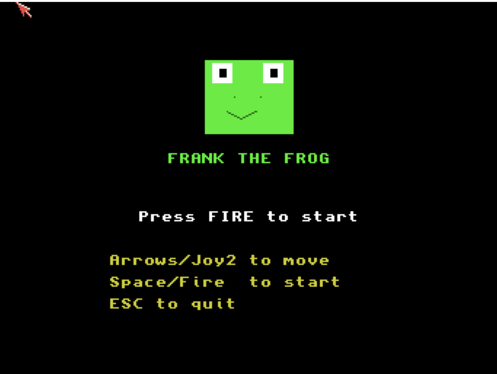

# Frank the Frog
**Platform:** Classic Amiga (68k, AGA A1200/A4000 class) · **Source:** `examples/frank_the_frog/` · **Type:** game

A road-and-river crossing arcade game: help Frank hop through traffic and ride logs and turtles to the ponds. Its soundtrack is a heavy-metal track generated in code by a small MOD-style player (`modplay.c`) that drives Paula directly, borrowing channel 3 for sound effects; graphics are double buffered on a 16-colour screen with `ChangeScreenBuffer`. It registers with the bridge as `frank_frog`, exposing `score`, `lives`, `level`, `game_state`, `frog_row` and `frog_col` plus `reset` and `status` hooks.

## Title screen

A large green frog face over the "FRANK THE FROG" title, "Press FIRE to start" and the control list.

## Gameplay

Frank is halfway across the road among red, blue and yellow cars and a purple bus; above is the river with logs and pairs of green turtles, and four home ponds on the top bank. The HUD reads SCORE 000020, HI 000020, LVL 1 with 3 lives.

**Controls:** Cursor keys or joystick: hop · Space, Return or fire: start · Esc: quit
