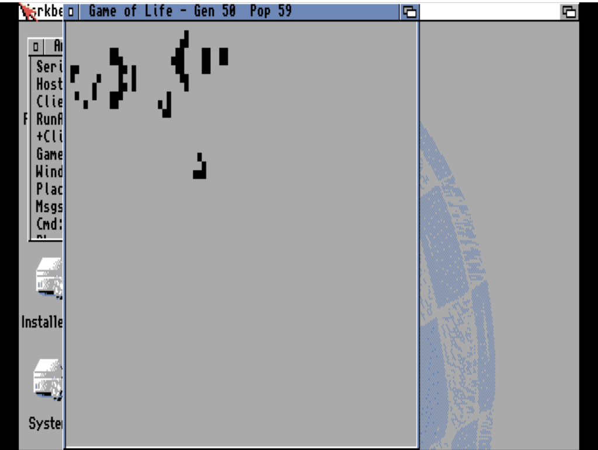

# Game of Life
**Platform:** Classic Amiga (68k, AGA A1200/A4000 class) · **Source:** `examples/game_of_life/` · **Type:** demo

Conway's Game of Life on an 80x60 grid of 5-pixel cells in a Workbench window, double-buffered between two grids. It is built to be driven over the bridge: it registers as `game_of_life` with variables `generation`, `population`, `speed`, `running`, `grid_w`/`grid_h`, hooks `clear`, `randomize` (density %), `glider` (x,y), `gosper` and `toggle_pause`, and a `grid` memory region with the live cells.

## Random soup

"Game of Life - Gen 20 Pop 724": black cells on grey from a random fill.

## Gosper glider gun

After the bridge hook `gosper`: "Gen 50 Pop 59", a Gosper glider gun at the top left emitting gliders.

**Controls:** click toggles a cell while paused; close gadget quits. **Bridge hooks:** `clear`, `randomize`, `glider`, `gosper`, `toggle_pause`.
