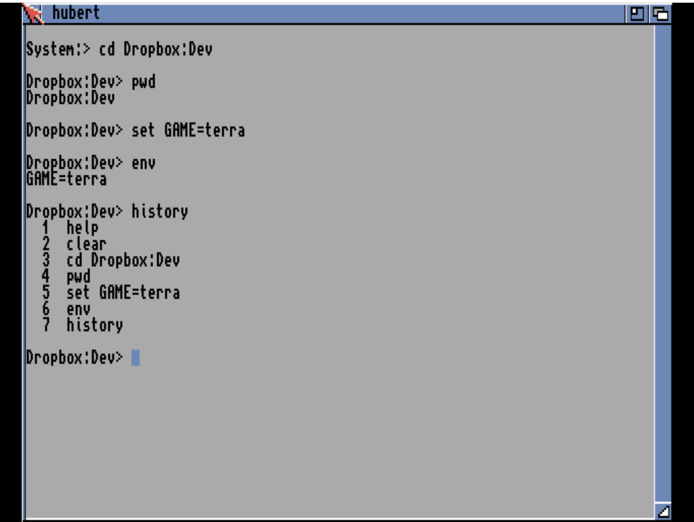

# hubert
**Platform:** Classic Amiga (68k, AGA A1200/A4000 class) · **Source:** `examples/hubert/` · **Type:** tool

hubert is a small interactive shell for AmigaOS. It reads keypresses from a RAW: console and runs its own line editor with history and Tab path completion, dispatching built-ins (`cd`, `pwd`, `echo`, `clear`, `help`, `history`, `set`, `env`, `exit`) or running external commands through `SystemTagList`. Its source also has an `ask` command that chats with an Ollama LLM server over bsdsocket TCP, with tools the model can call (`run_command`, `read_file`, `write_file`, `list_dir`, `system_info`). When the bridge daemon is running it registers as the `hubert` client: every command line is logged with its exit code, the working directory is exposed as the string variable `cwd`, and a `run` hook lets the host type a command into it and get the output back as the hook result (an `llm_event` hook feeds it streamed LLM events); without the bridge it works as a plain shell. Its core modules have host-side unit tests (`tests/`).

## Session: help

The "hubert" console window on the Workbench: the banner "hubert 0.4 — type 'help' for built-ins, 'exit' to quit" (the dash shows as a garbled "â" character), the prompt `System:>`, and the output of `help` listing the built-ins cd, pwd, echo, clear, help, history, set, env and exit.

## Session: navigating and environment

A short session: `cd Dropbox:Dev` changes the prompt to `Dropbox:Dev>`, then `pwd`, `set GAME=terra`, `env` (printing GAME=terra) and `history` listing the seven commands entered. (In this session typing `exit` did not close the window; Ctrl-C did.)

**Controls:** Type commands and press Return; Tab completes paths; cursor up/down recall history. `help` lists the built-ins, `exit` quits.
